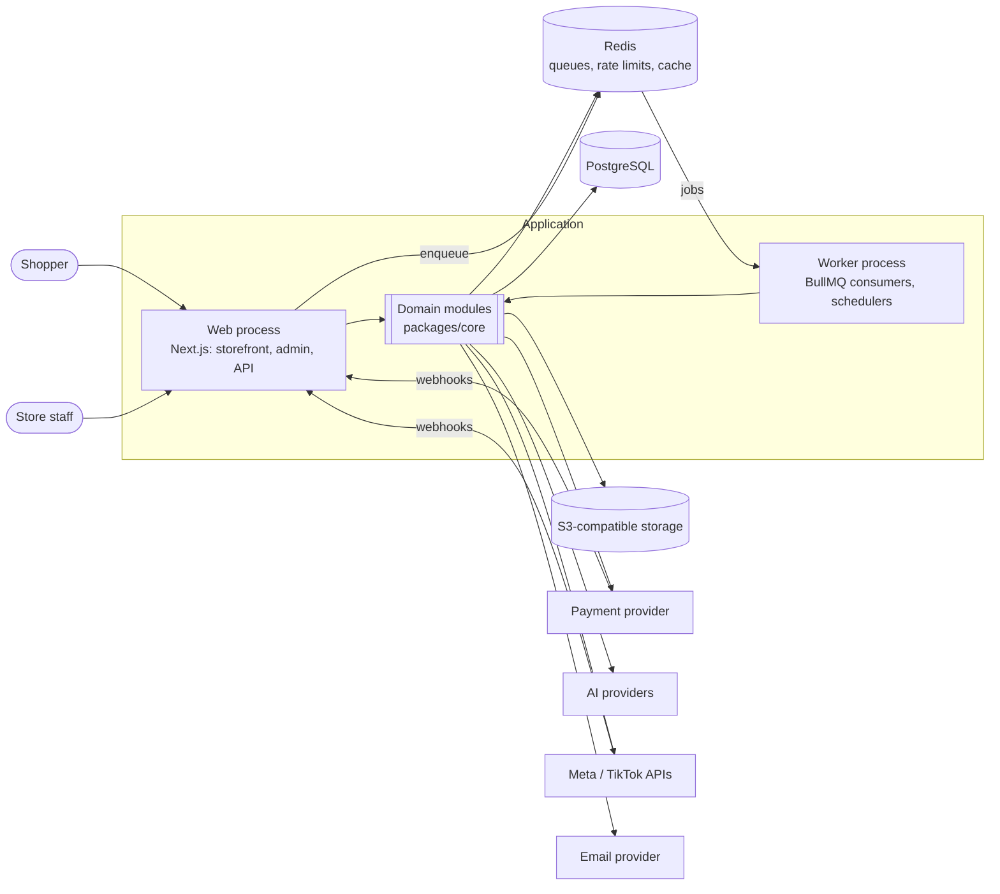
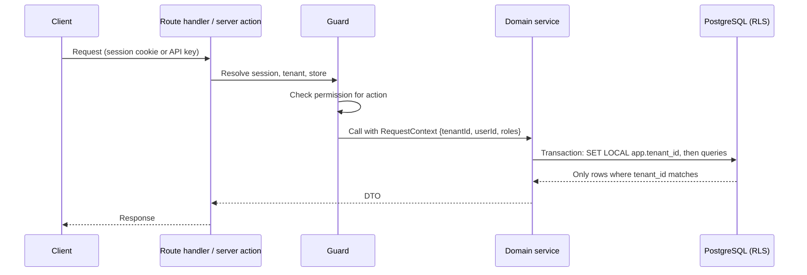
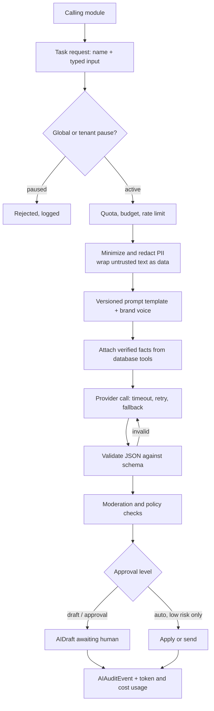
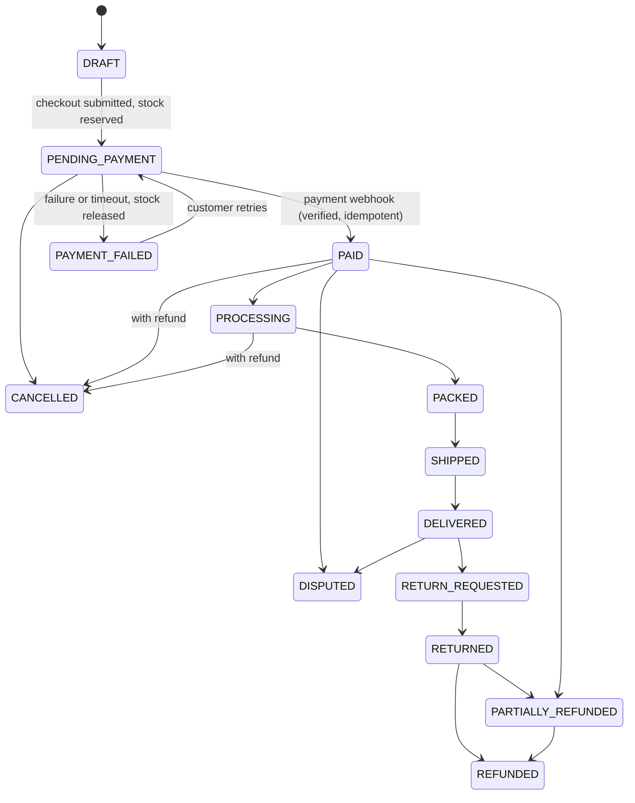

# Architecture

Last updated: 2026-11-11 (Milestone 1.1). Sections describe the planned architecture; so far only the scaffold exists: processes, health and readiness endpoints, env validation, logging, one queue.

Update this file whenever the architecture changes.

## 1. Shape of the system

A modular monolith. One codebase, two deployable processes (web and worker), one PostgreSQL database, one Redis, one object store. Domain modules are separate packages with explicit public interfaces so any of them can be extracted into a service later.



## 2. Repository layout (planned)

```
apps/
  web/            Next.js app: (storefront), (admin), api/v1, webhooks
  worker/         Job consumers and scheduled tasks
packages/
  core/           Domain modules (see section 3)
  db/             Prisma schema, migrations, seed, tenant-scoped client, RLS SQL
  config/         Environment validation, feature flags
  ui/             Design system components
  testing/        Factories, test database helpers, mock providers
docs/             Data model, API, security, compliance
scripts/          healthcheck (environment health check), backup, restore
```

## 3. Domain modules

Each module lives in `packages/core/src/<module>` and exposes services and DTO types only. Modules never import another module's internals or query another module's tables directly; they call its service interface or react to its domain events.

| Module | Owns |
| --- | --- |
| identity | Users, sessions, MFA, roles, permissions, memberships |
| tenancy | Tenants, stores, settings, feature flags, domains |
| catalog | Categories, brands, products, variants, attributes, media links |
| inventory | Locations, levels, reservations, stock movements, suppliers, purchase orders |
| cart | Carts, items, pricing preview |
| checkout | Checkout sessions, totals, tax and shipping quotes |
| payments | Payments, payment events, refunds, provider adapters |
| orders | Orders, items, state machine, notes |
| fulfillment | Shipments, tracking, returns |
| customers | Customer profiles, addresses, consent, notes, deletion and export |
| reviews | Reviews, responses, reports, UGC submissions, permissions |
| promotions | Coupons, promotions, gift cards |
| giveaways | Campaigns, entries, eligibility, draws, winners, fulfillment |
| content | Media assets, content posts, calendar, approvals, image processing |
| social | Account connections, inbox (conversations, messages, comments), publishing, automation rules |
| ai | Gateway, prompt templates, brand voice, drafts, usage, audit |
| marketing | Plans, campaigns, segments, UTM links, ads drafts |
| research | Competitor profiles, observations, opportunity scores |
| notifications | Templates, channels, preferences, delivery log |
| analytics | Events, reports, dashboards, exports |
| billing | SaaS plans, subscriptions, usage metering |
| platform | Platform administration, audit log, job status |

## 4. Request path and tenant isolation

Tenant isolation is enforced in three independent layers so that a mistake in one does not leak data.



1. **Guard.** Every handler resolves a `RequestContext` and checks a named permission (for example `orders.refund`). No handler reaches a service without one.
2. **Tenant-scoped data access.** Services receive a database client bound to the context's tenant. It adds `tenantId` to every read and write. The unscoped client is only available to platform-admin code and migrations, and its use is lint-restricted.
3. **Row-Level Security.** Every tenant-owned table has an RLS policy comparing `tenant_id` to a transaction-local setting. The application connects as a role that cannot bypass RLS.

Storefront requests resolve the tenant from the host name (custom domain or subdomain). Admin requests resolve it from the user's active membership.

An automated test suite creates two tenants and asserts, for every service and every API route, that tenant A's user cannot read or change tenant B's data. A new route without an isolation test fails CI.

## 5. Roles and permissions

Permissions are fine-grained strings (`module.action`). Roles are named sets of permissions. Seeded roles: platform administrator, store owner, store manager, inventory manager, marketer, customer-service agent, content editor. Tenants can later define custom roles. Sensitive actions (refunds, giveaway draws and redraws, ad launch, data export, automation level changes) each have their own permission and always write an audit log entry.

## 6. Background jobs

BullMQ queues, one per concern: `payments`, `notifications`, `media`, `ai`, `social-inbound`, `social-outbound`, `giveaways`, `research`, `analytics`, `maintenance`.

- Every job carries `tenantId` and an idempotency key. Handlers are safe to run twice.
- Retries use exponential backoff. Jobs that exhaust retries go to a dead-letter queue visible in the admin.
- Database change and job enqueue are made atomic with a transactional outbox table drained by the worker.
- Scheduled work (closing giveaways, releasing expired stock reservations, token refresh, metric sync) runs as repeatable jobs.
- A `Job` status record backs the "background job status" API.

## 7. External providers

Every external dependency sits behind an interface in the owning module, with a mock implementation used in tests and local development, and a feature flag that disables it safely.

| Interface | First adapters |
| --- | --- |
| `PaymentProvider` | mock, Stripe |
| `ShippingProvider` | flat-rate table, then a carrier |
| `TaxCalculator` | fixed-rate per region |
| `EmailProvider` | console (dev), SMTP |
| `StorageProvider` | S3-compatible |
| `SearchProvider` | PostgreSQL full-text |
| `AIProvider` | mock, Anthropic, OpenAI-compatible |
| `ImageProcessor` | local (sharp) for resize; provider for background removal |
| `SocialPlatform` | Meta (Facebook, Instagram), TikTok |
| `AdsPlatform` | Meta Ads |

## 8. AI gateway

No code outside the `ai` module calls an AI provider. Callers request a named task (for example `product.description`, `inbox.classify`) with typed input.



Key rules:
- **Grounding.** Stock, price, discount, delivery, order, refund and policy facts are fetched by the gateway from the database and passed as structured facts. Output schemas for customer-facing replies require a citation to a supplied fact for any such claim; uncited claims fail validation. If a fact is missing the reply must say it is unavailable.
- **Prompt injection.** Customer messages, comments, reviews and scraped pages are always passed as delimited data, never as instructions. The model has no tools that change state; state changes happen only in application code after validation and approval.
- **Three automation levels** per tenant and per channel: draft only, human approval required, automatic for low-risk categories. Refunds, payment problems, legal matters, threats, privacy requests, angry customers and account problems always go to a human.
- **Evaluation.** A fixed test set per task runs against the mock provider in CI and against real providers on demand.

## 9. Order and payment flow



Transitions are defined in one table in the `orders` module; anything not listed is rejected. Each transition writes an order event. Payment state is only changed by verified provider webhooks, never by the browser redirect. Card data never touches the application; only provider tokens and the last four digits and brand are stored.

## 10. Giveaway draw integrity

- Entries become eligible only after verified payment (or approved free entry) and eligibility checks.
- The campaign closes by scheduled job at the configured time; late entries are rejected by a database constraint as well as application code.
- The draw selects an index with Node's `crypto.randomInt` over the ordered list of eligible entry IDs. The run records the count of eligible and excluded entries, a hash of the ordered eligible list, the method, the selected entry, the winner, the administrator and the time.
- After a draw, database triggers reject updates and deletes on that campaign's entries, the run and the winner. Disqualification and redraw add new rows that reference the earlier run; nothing is overwritten.
- Fraud signals only flag entries for review. No automated process removes a customer or entry.

## 11. Social integration

`SocialPlatform` adapters declare capabilities (for example `comments.read`, `messages.reply`, `posts.schedule`). The UI and services consult capabilities at run time and show the manual-workflow message for anything unsupported. Tokens are encrypted at rest with a key from the environment. Webhooks are signature-verified, stored raw, de-duplicated by platform event ID and processed from a queue. Outbound replies and posts go through the approval queue.

## 12. Environments

| Environment | Database, Redis, storage | Providers |
| --- | --- | --- |
| Local | docker-compose | Mock payment, console email, mock AI by default |
| Test (CI) | Service containers | Mocks only |
| Staging | Managed or compose on a server | Provider sandboxes and test mode |
| Production | Managed, with backups | Live |

Configuration comes only from environment variables, validated at startup. Feature flags per tenant are stored in the database.

## 13. Cross-cutting

- **Errors.** One error type hierarchy mapped to a consistent API error body (see API specification).
- **Logging.** JSON logs with request ID, tenant ID and user ID. Secrets and personal data are redacted.
- **Audit.** `AuditLog` records who did what to which record, with before and after for sensitive changes.
- **Health.** `/api/health` (process up) and `/api/ready` (database, Redis and storage reachable). `pnpm healthcheck` checks a development machine.
- **Security headers.** Content Security Policy, HSTS, frame and referrer policies set in middleware.
- **Money.** Integer minor units plus ISO currency code. No floating-point arithmetic on money.
- **Time.** Stored in UTC; displayed in the store's time zone.
