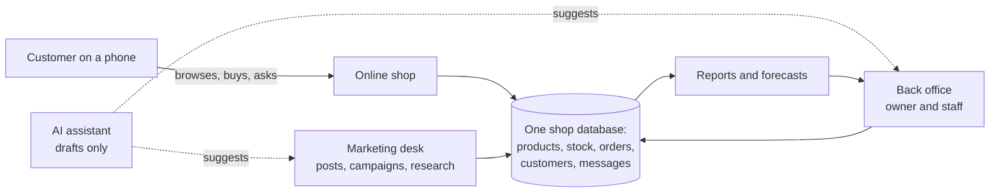
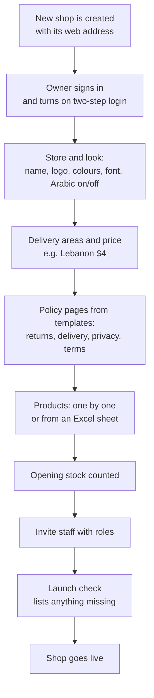
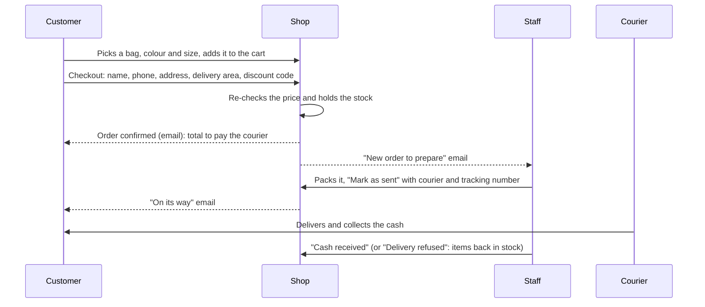
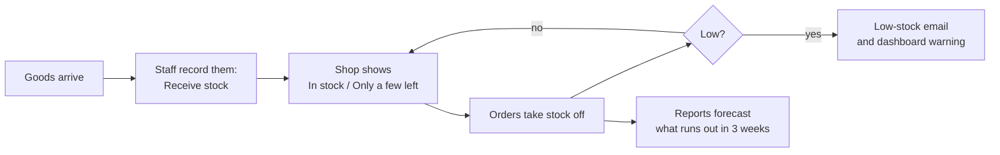
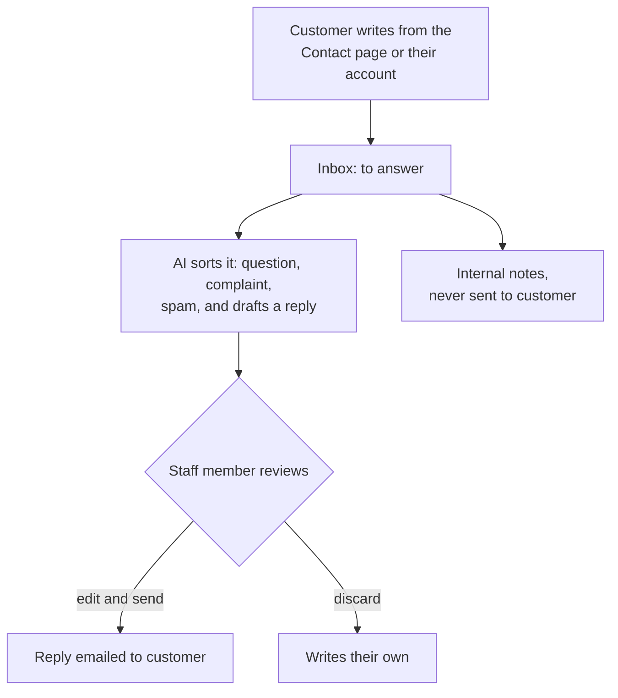
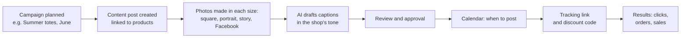
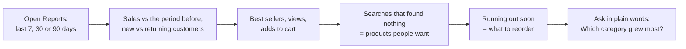

# Business Blueprint

**Who this is for:** shop owners, investors, partners and anyone deciding whether to buy or use the system. You don't need to know anything about code to read it.
**The technical blueprint** (how the system is built) is in [PROJECT_PLAN.md](../PROJECT_PLAN.md) and [ARCHITECTURE.md](../ARCHITECTURE.md).

Last updated: 2026-11-19

---

## 1. The idea in one paragraph

Small shops that sell on Instagram and Facebook often run on direct messages, a notebook and memory. Orders get lost, items sell twice, nobody knows which post brought in sales, and the owner answers the same questions all day. **This system puts the whole shop in one place:**
- a fast online store that works well on phones (English and Arabic);
- a back office for orders, stock, deliveries, returns and customers;
- a marketing desk for planning posts, photos, campaigns and research;
- an AI assistant that drafts the routine work, while a person approves anything that matters.

It was built first for a real accessories shop in Lebanon (bags, wallets, watches, jewellery). It is designed so the same system can be rented to many other shops, each with its own name, look and data.

---

## 2. The problem we solve

| What goes wrong in a typical small shop today | What the system does instead |
| --- | --- |
| Orders arrive in DMs and get lost or forgotten | Every order is in one list with a status: new, sent, paid, cancelled, returned |
| The same item is sold to two customers | Stock is counted. When the last piece is bought it is held for that customer, and the shop shows "sold out" |
| Cash-on-delivery money is hard to track | Every cash order shows how much the courier should collect, and staff mark "cash received" or "refused" |
| "How much is this? Do you deliver?" all day | Product pages show the price, stock and delivery fee. The AI drafts replies to messages, and staff send them |
| No idea which post or campaign made money | Tracking links, discount codes per campaign, and reports on sales, best sellers and campaign results |
| Content is made in a rush, with no plan | A content calendar, photo versions sized for each platform, AI-drafted captions and a review step |
| Competitors' prices are guessed | A research notebook: what competitors sell and charge, next to your own price, with AI ideas |
| The owner does everything | Staff roles: each person sees only the parts of the shop they work on |

---

## 3. The big picture

The system has four parts that share one set of data.

- **The shop** is what customers see.
- **The back office** is where the team works.
- **The marketing desk** plans and measures promotion.
- **The AI assistant** writes drafts, and people decide what to use.

---

## 4. Who it's for

**Ideal customers**
- Small and medium shops (1 to 20 staff) that sell physical products and get most of their sales through social media.
- Shops where cash on delivery is common, and markets where Arabic and English are both needed (Lebanon, the Gulf, the wider region).
- Owners who want their own branded shop rather than just a page on a marketplace.

**Not a fit (yet)**
- Marketplaces with many sellers in one shop.
- Shops that need a till for in-person sales (point of sale).
- Businesses that need native phone apps. The shop works in the phone's browser and can be saved to the home screen.

---

## 5. How it works, step by step

Each workflow below describes what people do and what the system does for them.

### 5.1 Opening a new shop

The product spreadsheet comes as a ready-made Excel template with drop-down lists. Mistakes are shown row by row before anything is saved, and picture links are downloaded automatically.

### 5.2 A customer places an order (cash on delivery)

- Guests can check out without an account. Customers with an account see their orders and saved addresses.
- Online card payment is ready to connect once the shop has a merchant account with a local card provider (see section 8).

### 5.3 Stock: from the supplier to "running low"

Every change records who made it, why and when: received, counted, damaged, sold or returned. That history can't be edited, so stock never goes missing without a trace.

### 5.4 Returns and refunds

1. On a delivered and paid order, staff record what came back, how many, whether it can be sold again, and the reason.
2. Items that can be sold again go straight back into stock. Damaged ones are logged.
3. If money is given back (cash, bank transfer or other), it is recorded with the order, and only staff allowed to give refunds can do it.

### 5.5 Customer messages, with an AI first draft

- The AI only uses real facts from the shop: prices, stock, the order's status and the shop's policies. If it doesn't know, it says so instead of guessing.
- Nothing is sent to a customer without a person approving it.
- Messages from Instagram and Facebook will arrive in the same inbox once the shop's Meta accounts are connected (section 8).

### 5.6 Marketing: from an idea to measured results

- **Photos:** one product photo becomes versions for each platform, with the background removed when it's plain, plus a white, blurred or transparent background.
- **Captions:** the AI writes from the real product details and never invents prices, discounts or fake urgency ("only 2 left!" when it isn't true).
- **Customer lists:** for example "bought twice or more", "spent over $100" or "no order in 90 days". Only customers who agreed to marketing can be exported.
- **Results:** each campaign shows its link clicks and the orders that used its discount code.

### 5.7 Competitor research

1. Staff add the shops they compete with, with their website and social accounts.
2. When they see something worth noting (a price, a new product, a post that's doing well, an offer), they write it down with the link and the date.
3. A price they saw can be linked to the shop's own similar product, for example "Their price $65 · ours $79 (ours is $14 more)".
4. **Draft ideas with AI** turns those notes into up to 5 ideas, each scored from 0 to 100, with the reasons and the notes it's based on. Staff keep or dismiss each one.

Nothing is collected from competitors' sites automatically. People look at public pages, which respects every site's rules.

### 5.8 Reviews and customer photos

- Only customers who actually received the product can review it. Reviews are marked "Verified purchase" and appear after staff approve them, and the shop can reply publicly.
- Customers can share photos or short videos of what they bought, after ticking a clear permission statement. Approved ones appear on the product page and in a "Customer photos" gallery.

### 5.9 The owner's weekly routine

The reports also show a sales forecast for the next 14 days. Questions are answered only from the figures on the page, with the figures quoted.

---

## 6. The team: who does what

Each person signs in with their own account and sees only what their role allows. Every important action is recorded with who did it and when.

| Role | Typical person | Can do |
| --- | --- | --- |
| **Owner** | The shop owner | Everything, including team, settings and money |
| **Manager** | Runs daily operations | Orders, stock, customers, refunds, reports, marketing |
| **Inventory manager** | Warehouse or stock person | Products and stock |
| **Marketer** | Social media or marketing person | Campaigns, posts, research, customer lists, reports |
| **Customer service** | Answers messages | Inbox, customers, order lookups |
| **Content editor** | Photographer or designer | Photo library, posts, captions |

---

## 7. The AI assistant: what it does and what it never does

**It helps with:**
- product descriptions and search-engine text, in English and Arabic;
- product categories and tags;
- sorting customer messages and drafting replies;
- social media captions;
- research ideas and answers to questions about the reports.

**It never:**
- invents prices, stock, discounts, delivery dates, order status or policies. Those always come from the shop's real data;
- sends anything to a customer, publishes anything or spends money without a person approving it;
- writes fake reviews, fake urgency or fake scarcity, or suggests copying other shops' content;
- follows instructions hidden inside customer messages (it is tested against these tricks).

**Cost control:** each shop has a monthly AI budget, and there is one switch to pause all AI instantly. Every AI use is logged.

---

## 8. What is ready today, and what is next

Honest status as of the date at the top.

| Area | Status |
| --- | --- |
| Online shop (phone-first, English and Arabic, search, filters, cart, accounts) | ✅ Ready |
| Checkout with cash on delivery, delivery areas, discount codes | ✅ Ready |
| Orders, stock, returns, customers, store emails, dashboard, CSV exports | ✅ Ready |
| Reviews, customer photos and videos, contact inbox | ✅ Ready |
| Each shop's own look (logo, colours, fonts) and policy pages | ✅ Ready |
| AI: product text, message sorting and reply drafts, captions | ✅ Ready (needs an AI provider account) |
| Content library, photo versions, calendar, campaigns, tracking links, customer lists | ✅ Ready |
| Competitor research and AI ideas | ✅ Ready |
| Reports, forecasts, plain-word questions | ✅ Ready |
| Security hardening before launch | 🔧 In progress |
| Online card payments | ⏳ Waiting for a merchant account with a Lebanese card provider (areeba or NetCommerce) |
| Instagram and Facebook: messages, comments, publishing, video views | ⏳ Waiting for the shop's Meta business accounts (see [META_SETUP.md](META_SETUP.md)) |
| Facebook and Instagram ads (drafts, approval, results) | ⏳ Waiting for an ad account |
| TikTok publishing | 📅 Planned |
| Giveaways and prize draws | 📅 Planned (legal check needed first, see [COMPLIANCE.md](COMPLIANCE.md)) |
| Self-service sign-up for new shops, subscription billing, platform admin | 📅 Planned. Today, new shops are set up by us |

---

## 9. How to sell it

### 9.1 Business model options

| Model | How it works | Good for |
| --- | --- | --- |
| **Monthly subscription (SaaS)** | Each shop pays monthly. We host, update and back it up | Recurring income; most shops |
| **Setup fee + subscription** | A one-time fee covers setup: products imported, branding, policies, staff training | Shops that want it done for them |
| **Done-for-you package** | Setup, monthly content help and campaign management on top of the system | Owners with no marketing person |
| **Private installation** | A larger business gets its own copy on its own server, with a yearly licence and support | Bigger brands with their own IT |

### 9.2 Suggested plans (prices are yours to set)

| | **Starter** | **Growth** | **Pro** |
| --- | --- | --- | --- |
| Shop, checkout, orders, stock, emails | ✅ | ✅ | ✅ |
| Staff accounts | 2 | 5 | 15 |
| Reviews, customer photos, inbox | ✅ | ✅ | ✅ |
| AI assistant (monthly AI budget) | small | medium | large |
| Content calendar, photo versions, campaigns | — | ✅ | ✅ |
| Competitor research, reports with forecasts | — | ✅ | ✅ |
| Instagram and Facebook inbox, ads (when ready) | — | — | ✅ |
| Own web address (yourshop.com) | ✅ | ✅ | ✅ |
| Monthly price | [PRICE] | [PRICE] | [PRICE] |

**What it costs you to run each shop** (to price above): server and storage, email sending, AI usage (capped per shop by its budget), the domain, and your support time. Card-payment fees are paid by the shop to its card provider.

### 9.3 Why a shop would choose this

1. **Built for how they really sell:** cash on delivery first, social media first, phone first.
2. **Arabic and English** in the shop, the emails and the policies, laid out right to left.
3. **Everything in one place:** shop, stock, orders, messages, content, campaigns, research and reports. That's 4 or 5 separate tools replaced.
4. **AI that saves time without embarrassing the shop:** it drafts, people approve, and it never invents facts.
5. **Honest selling:** no fake reviews, fake countdowns or fake "only 2 left". That protects the shop's reputation and keeps it within platform rules.
6. **Safe:** each shop's data is walled off from every other shop's, staff use two-step login, the data is backed up and every action is logged.

### 9.4 A 10-minute demo for a prospect

1. **The shop on a phone (2 min):** browse, switch to Arabic, open a product, pick a colour, add to cart, check out with cash on delivery.
2. **The order arrives (2 min):** the back office dashboard, the new order, "Mark as sent", then "Cash received", and the emails the customer got.
3. **Stock (1 min):** the item's stock went down, the low-stock warning, the history of every change.
4. **AI help (2 min):** draft a product description, then a reply to a customer question, both edited and approved by a person.
5. **Marketing (2 min):** one photo turned into Instagram and story sizes, an AI caption, the calendar, and a campaign with its tracking link and results.
6. **Reports (1 min):** best sellers, searches with no results, what runs out soon, and a question asked in plain words.

---

## 10. Trust and safety, in plain words

- **Each shop's data is private to that shop.** The system is built so one shop can never see another's orders or customers, and this is tested automatically on every change.
- **Logins are protected:** strong password storage, a lock after repeated wrong passwords, and two-step login (an authenticator app) for owners and managers.
- **Payments:** card details are never stored by the system. They go to the card provider.
- **Backups:** the database is backed up and restoring it has been tested.
- **Customer privacy:** marketing only to customers who agreed, with a history of their choice. Personal details stay out of the shop's visit statistics.
- **Records:** important actions (refunds, exports, setting changes, sign-ins) are written to a log that can't be edited.

---

## 11. Questions buyers ask

**Do I need technical skills?** No. Everything is done from the back office in a browser, on a computer or a phone.

**Can I use my own web address?** Yes, each shop can have its own (for example yourshop.com).

**Can my customers pay by card?** Cash on delivery works today. Card payment connects once you have a merchant account with a local card provider.

**Does it post to Instagram for me?** Planning, photos, captions and approval are ready today, and you post the approved content yourself. Direct publishing and the Instagram inbox switch on once your Meta business accounts are connected and approved by Meta.

**Will the AI reply to my customers by itself?** No. It drafts and a person sends. This is on purpose.

**What if I stop using it?** Orders can be downloaded as spreadsheets at any time, and a full copy of the shop's data can be handed over.

**Is my data shared with other shops?** Never. See section 10.

---

## 12. Words used in this document

| Word | Meaning |
| --- | --- |
| **Back office** | The private part of the system where staff work (also called "admin") |
| **SaaS** | "Software as a service": shops rent the system monthly instead of buying and installing it |
| **Tracking link** | A short link for a post or campaign that counts how many people clicked it |
| **Customer list (segment)** | A group of customers picked by what they bought or spent |
| **Merchant account** | An account with a card provider that lets a shop accept card payments |
| **Two-step login** | Signing in with a password plus a code from a phone app |
| **Forecast** | An estimate of the coming days' sales or stock, based on recent sales |
