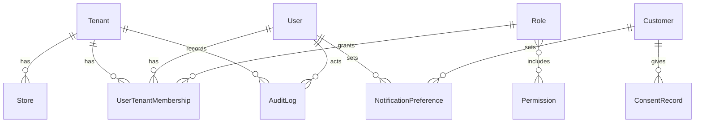
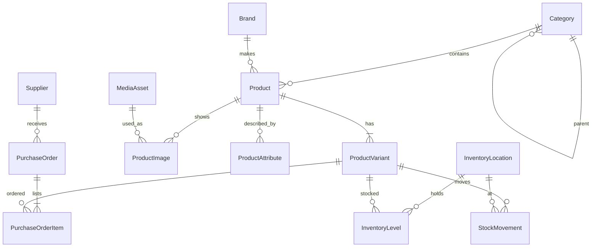
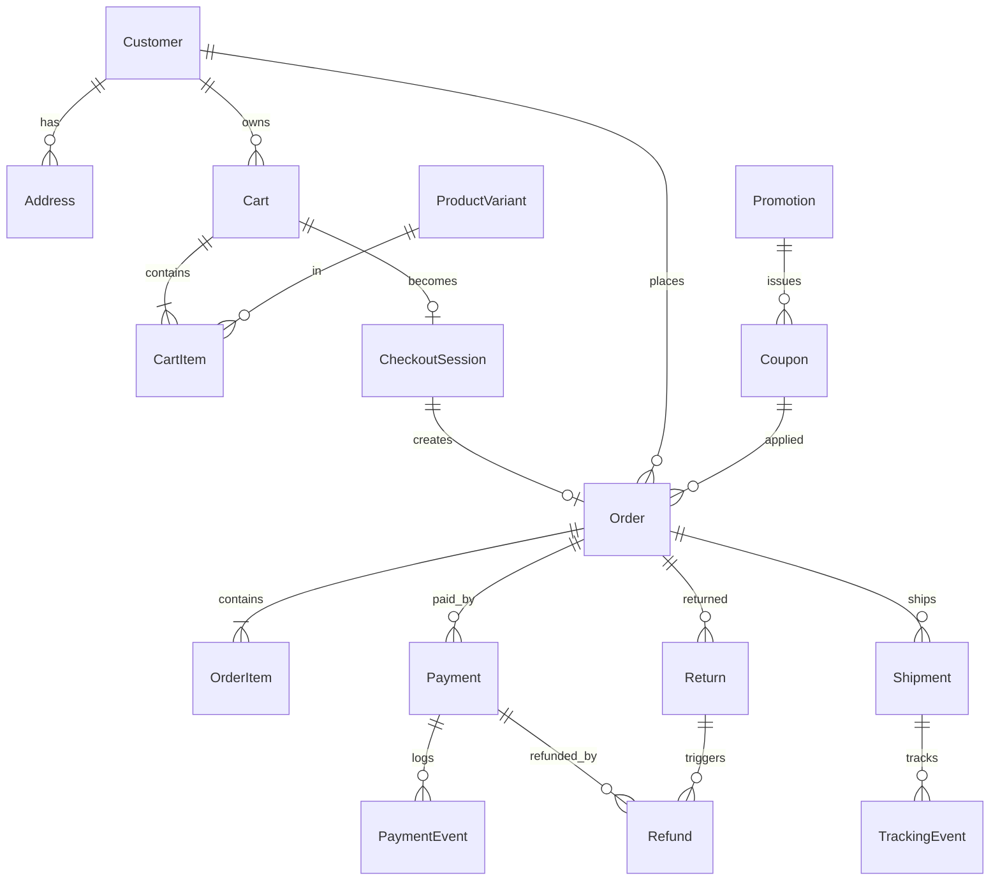
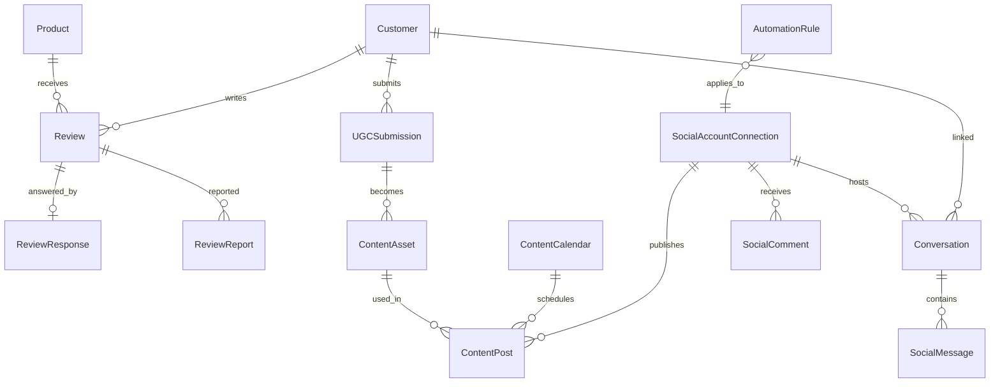
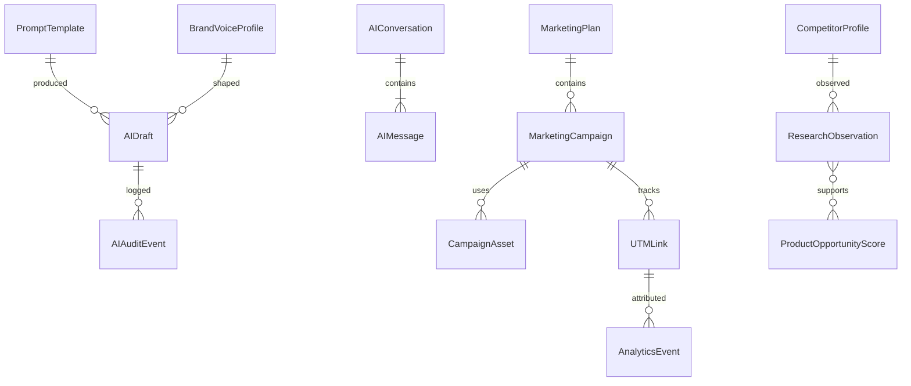
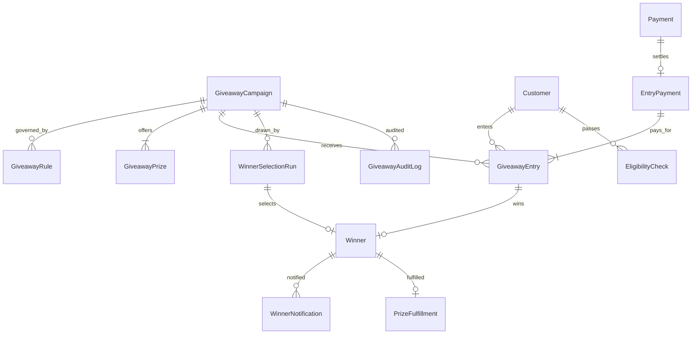

# Data Model

Last updated: 2026-11-11 (Milestone 1.3). `packages/db/prisma/schema.prisma` and the migrations are the source of truth. Sections 1 and 7 below are implemented; the rest is still design.

**Implemented so far:** `tenants`, `stores`, `users`, `roles`, `permissions`, `role_permissions`, `user_tenant_memberships`, `audit_logs`, `consent_records`, `notification_preferences`, `feature_flags`, `idempotency_keys`, `outbox_events`, `jobs`, and the authentication tables `sessions`, `accounts`, `verifications`, `two_factors`.

## Conventions

- Naming: this document uses model names (`Tenant`); in the database, tables are plural snake_case (`tenants`) and columns are snake_case.
- Primary keys: UUID v7 (time-ordered), column `id`, generated by the client.
- Every tenant-owned table has `tenant_id` (not null, indexed, covered by an RLS policy). Store-scoped tables also have `store_id`.
- `created_at`, `updated_at` on every table. Soft delete (`deleted_at`) only where history must survive (products, customers, users).
- Money: integer minor units (`*_amount`) plus `currency` (ISO 4217).
- Statuses are database enums.
- Uniqueness is per tenant: for example `(tenant_id, slug)`, `(tenant_id, sku)`.
- Append-only tables (no update or delete, enforced by trigger): `AuditLog`, `StockMovement`, `PaymentEvent`, `TrackingEvent`, `AIAuditEvent`, `GiveawayAuditLog`, `WinnerSelectionRun`, order events.
- Translatable text (product name, description, SEO fields, category name) lives in `*Translation` tables keyed by locale.

## 1. Tenancy and users

| Table | Key fields |
| --- | --- |
| Tenant | name, slug, status, plan_id, ai_monthly_budget_amount, automation_paused |
| Store | tenant_id, name, slug, default_locale, default_currency, timezone, domains, branding (JSON), settings (JSON) |
| User | email (unique), password_hash, mfa_enabled, is_platform_admin, status |
| Role | tenant_id (null for system roles), key, name |
| Permission | key (`module.action`), description |
| UserTenantMembership | user_id, tenant_id, role_id, store_ids (optional restriction), status |
| AuditLog | tenant_id, actor_type, actor_user_id, action, entity_type, entity_id, before, after, ip, request_id. No foreign keys, so entries outlive what they describe. Update, delete and truncate are rejected by trigger for every role. |
| ConsentRecord | tenant_id, subject_type (user, customer), subject_id, purpose (marketing_email, marketing_sms, cookies_analytics, cookies_marketing, ugc_reuse), granted, source, policy_version, recorded_at. One row per decision; withdrawal adds a row. `subject_id` gets a foreign key to customers in Phase 3. |
| NotificationPreference | subject (user or customer), channel, category, enabled |

**Access rules implemented (runtime role `app_user`):**

| Table | Read | Write |
| --- | --- | --- |
| tenants | Own row | Update own row; no create or delete |
| stores, consent_records, notification_preferences, idempotency_keys, outbox_events, jobs | Own tenant | Own tenant |
| store_domains, categories, brands, products, product_variants, product_attributes, media_assets, product_images, carts, cart_items, customers, customer_sessions, customer_tokens, addresses, inventory_locations, inventory_levels, stock_reservations | Own tenant | Own tenant |
| stock_movements | Own tenant | Own tenant, insert only (no update or delete) |
| order_counters, orders, payments | Own tenant | Own tenant, no delete |
| shipping_zones | Own tenant | Own tenant |
| checkout_settings | Own tenant | Own tenant, no delete |
| shipments | Own tenant | Own tenant, add only |
| notification_settings | Own tenant | Own tenant, no delete |
| order_returns, order_return_items | Own tenant | Own tenant, add only |
| discount_codes | Own tenant | Own tenant |
| discount_redemptions | Own tenant | Own tenant, add only |
| product_imports, product_import_images | Own tenant | Own tenant, no delete |
| product_reviews | Own tenant | Own tenant, no delete |
| review_reports | Own tenant | Own tenant, add only |
| ugc_items | Own tenant | Own tenant, no delete |
| support_conversations | Own tenant | Own tenant, no delete |
| support_messages, customer_notes | Own tenant | Own tenant, add only |
| store_pages | Own tenant | Own tenant, no delete |
| product_translations, category_translations | Own tenant | Own tenant |
| ai_settings, business_profiles | Own tenant | Own tenant, no delete |
| ai_events | Own tenant | Own tenant, add only |
| support_reply_drafts | Own tenant | Own tenant, no delete |
| product_suggestions | Own tenant | Own tenant, no delete |

**Support AI (2026-11-22, decision D103):** `support_conversations` gains AI labels (category, urgency, one-line summary, the newest customer message looked at, failed tries). `support_reply_drafts` (one per AI draft: the message it answers, text, the facts it used, whether the facts answered it, pending, sent, dismissed or replaced, whether staff edited it before sending, who decided and when).

**AI (2026-11-21, decisions D96 to D98):** `ai_settings` (one per store: paused, monthly budget in millionths of a dollar or none for the platform limit, how much the AI does alone). `business_profiles` (one per store: what the AI is told about the business, as checked JSON). `ai_events` (one per AI run: task, provider, model, outcome, who must look at it, tokens, cost, time, problem, input without personal details, output, the fact ids it was given, the staff member).

**AI product drafts (2026-11-22, decision D99):** `product_suggestions` (one AI draft for a product: kind `copy` or `translation`, its language, status pending, applied, dismissed or replaced, the checked proposal as JSON, the parts staff applied, the AI run it came from, who asked and who decided). At most one pending draft per product, kind and language; the product, and the AI run, must be in the same store (trigger).

**Languages (2026-11-20, decisions D94 and D95):** `stores.languages` (the languages the shop is offered in: English, and Arabic when the store turns it on; the default is always one of them). `product_translations` and `category_translations` (one per product or category and language, Arabic only: name and descriptions; empty parts show the English). `orders.locale`, `support_conversations.locale` (the language the shopper used; their emails use it). `store_pages.locale` (one page per slug and language).

**Policy pages (2026-11-19, decision D92):** `store_pages` (one per store and page: returns, delivery, privacy or terms; title, plain text, published and when). A published page must have at least 50 characters.

**Support and customer notes (2026-11-19, decisions D90 and D91):** `support_conversations` (customer or guest email and name, subject, status open, waiting or closed, linked order, assigned staff, hash of the guest link key, last message time), `support_messages` (author customer, staff or internal note, author name, text; add-only), `customer_notes` (staff notes on a customer; add-only). `notification_settings.support_emails` lists staff told about new messages.

**Customer photos and videos (2026-11-18, decision D89):** `ugc_items` (the media asset, kind, source customer or staff, customer, product, caption, credit name, status pending, approved, rejected, hidden, withdrawn or removed, featured, exact permission wording and version, when given and withdrawn, the original post link for staff-added items, who added and moderated it). Checks: nothing approved without a file and live permission; withdrawn or removed items have no file; staff items need their source link. Never deleted by the application. Videos are media assets of kind `video`.

**Store look (2026-11-18, decision D87):** `stores.branding` (JSON: brand and accent colours, corners, font, tagline, contact email and phone; read with safe defaults) and `stores.logo_asset_id` (a media asset of the same tenant).

**Reviews (2026-11-18, decision D86):** `product_reviews` (product, customer, the qualifying order, rating 1 to 5, title, text, name shown, status pending, approved, rejected or hidden, store reply, who moderated) with a trigger that requires a sent order of the customer's containing the product, one per customer per product; `review_reports` (review, customer, reason; one per customer per review, add-only).

**Product imports (2026-11-18, decisions D84 and D85):** `product_imports` (file name, checked rows as JSON, problems, counts, status checked, imported or discarded) and `product_import_images` (one picture link per row, its product, and download status, attempts and error).

**Discount codes (2026-11-18, decision D83):** `discount_codes` (code unique per store, kind percent, fixed or free_delivery, value, minimum, first and last moment, total and per-customer limits, on or off) and `discount_redemptions` (one per order: code, email, amount; add-only). Orders gain `discount_code`, frozen with `discount_amount`.

**Returns (2026-11-17, decision D80):** `order_returns` (reason, note, refund amount and method, who recorded it) and `order_return_items` (order line, quantity, resellable or damaged), both add-only; a trigger keeps returned quantities within what was bought and on the same order. `orders.refunded_amount` holds money given back, at most the total and never decreasing.

**Store emails (2026-11-17, decisions D77 to D79):** `outbox_events` gains `available_at` (next try), `locked_until` (claimed by a sender) and `dedupe_key` (unique per tenant, so each email is made once). `notification_settings` holds one row per store with up to five staff addresses each for new orders and low stock (own tenant, no delete).

**Delivery and tax (2026-11-17, decisions D74 and D75):** `shipping_zones` (name, country codes, price and optional free-delivery amount in the store currency, offered or not), `checkout_settings` (one row per store: tax rate in hundredths of a percent, included in prices or added, tax name), `shipments` (one per order: courier, tracking number, https tracking link, sent time). Orders gain `shipping_zone_name`, `tax_rate_basis_points`, `tax_included_amount` and `tax_label`, frozen with the other amounts once placed.

**Cash on delivery (2026-11-17):** `orders.payment_method` (online or cash_on_delivery, fixed after placing), order status `confirmed` for accepted cash orders, and a check that online orders never use `confirmed` and cash orders never wait for payment. Cash collected is a `payments` row with provider `cash_on_delivery` (decision D72).
| order_items, order_events, payment_events | Own tenant | Own tenant, insert only (no update or delete) |
| user_tenant_memberships | Own tenant, plus the signed-in user's own memberships elsewhere | Own tenant |
| users | Self and members of the current tenant; never `password_hash` or `is_platform_admin` | Own `name` only |
| roles | System roles and own tenant's | Own tenant's non-system roles |
| role_permissions | For visible roles | For own tenant's roles |
| permissions | All (global catalogue) | None |
| feature_flags | Global defaults and own tenant's | Own tenant's |
| audit_logs | Own tenant | Insert for own tenant only |
| sessions, accounts, verifications, two_factors | None | None |

The four authentication tables follow the shape the Better Auth library requires. `accounts.password` holds the Argon2id hash for email-and-password sign-in (provider `credential`); `users` no longer has a password column. `two_factors` holds the encrypted authenticator secret and backup codes. `users` gained `email_verified` and `image`, and `name` is now required (empty by default). Helper functions used by the policies live in the `app_private` schema.

Platform administrator is the `is_platform_admin` flag on a user, not a membership. The plan reference on `Tenant` (`plan_id`) arrives in Phase 9.

Staff (`User`) and shoppers (`Customer`) are separate. A shopper with a login has a password hash on their `Customer` row; a guest has a `Customer` row with none (decision D56).

**Built (Milestone 3.1):** `customers` (email unique per tenant and stored lowercase, optional `password_hash`, `email_verified_at`, `status` active or disabled), `customer_sessions` and `customer_tokens` (only token hashes; tokens have a purpose, an expiry and a used time), `addresses` (ISO country code, at most one default for delivery and one for billing per customer by partial unique indexes), and `carts.customer_id`. All tenant-scoped with Row-Level Security and same-tenant triggers. Marketing consent uses the existing `consent_records` with `subject_type = customer`.

## 2. Catalog and inventory

| Table | Key fields |
| --- | --- |
| Category | parent_id, name, slug, position, seo_title, seo_description, image_asset_id |
| Brand | name, slug, logo_asset_id |
| Product | name, slug, description, short_description, seo_title, seo_description, brand_id, category_id, audience_tags[], material, care_info, tax_class, status (draft, active, archived), is_featured, is_new_arrival, is_best_seller, search_vector |
| ProductVariant | product_id, sku, barcode, color, size, option_values (JSON), cost_amount, price_amount, discount_price_amount, compare_at_amount, currency, weight_grams, length_mm, width_mm, height_mm, low_stock_threshold, position, status |
| ProductImage | product_id, variant_id (optional), media_asset_id, alt_text, position |
| MediaAsset | kind (image, video), storage_key, mime_type, bytes, width, height, duration_ms, checksum, variants (JSON), uploaded_by |
| ProductAttribute | product_id, key, value (specifications such as strap length, movement type) |
| Supplier | name, contact, lead_time_days, notes |
| PurchaseOrder / PurchaseOrderItem | supplier_id, status, expected_at; variant_id, quantity_ordered, quantity_received, unit_cost_amount |
| InventoryLocation | name, address, is_default |
| InventoryLevel | variant_id, location_id, on_hand, reserved, damaged; `available = on_hand - reserved - damaged` |
| StockMovement | variant_id, location_id, quantity_delta, bucket (on_hand, reserved, damaged), reason (purchase, sale, return, adjustment, damage, reservation, release), reference_type, reference_id, actor_user_id, note |

`is_best_seller` is a manual flag; a computed best-seller ranking from real order data is used for sorting. Stock levels shown to shoppers and given to the AI always come from `InventoryLevel`.

**Implemented so far (Milestone 2.1):** `categories`, `brands`, `products`, `product_variants` and `product_attributes`. Each has `tenant_id`, Row-Level Security (own tenant only, read and write) and these rules in the database:

- URL names (`slug`) are unique per tenant and limited to lowercase letters, digits and hyphens. SKUs are unique per tenant.
- A category parent, a product's category and brand, and a variant's or attribute's product must be in the same tenant (trigger, decision D34).
- Prices are never negative; a sale price is below the price and a compare-at price above it; currency is a three-letter uppercase code.
- Deleting a category or brand leaves its products in place without that category or brand. A category with sub-categories cannot be deleted.

**Media (Milestone 2.2):** `media_assets` and `product_images`, plus `categories.image_asset_id` and `brands.logo_asset_id`. Rules in the database:

- `media_assets.storage_key` must start with `public/<the row's tenant id>/`, so a tenant cannot register a file under another tenant's prefix.
- `media_assets` also has `status` (processing, ready, failed) and `processing_error`; `variants` is a list of `{ key, width, height, bytes, mimeType }`.
- A product image's product, variant and asset, a category's image and a brand's logo must be in the same tenant; an image's variant must belong to the image's product.
- An asset is used in one place only (unique links). Deleting the asset removes the product image row and clears a category or brand link.
- The lowest `position` is the main image (decision D41). Alternative text is 300 characters at most.

**Search (Milestone 2.3):** `products.search_vector` (type `tsvector`, GIN index) is filled by the trigger `products_search_vector` on insert and whenever the name, descriptions, material or audience tags change (decision D42). A partial index on `(tenant_id, created_at DESC) WHERE status = 'active'` serves storefront lists.

**Inventory (Milestone 3.2):** `inventory_locations` (one default per tenant), `inventory_levels` (unique per variant and location; check constraints keep every number non-negative and reserved plus damaged within on hand), `stock_movements` (non-zero delta, bucket, reason, reference, actor; insert and select only for the runtime role) and `stock_reservations` (holds for checkout with quantity, reference, expiry and status active, committed or released). `product_variants.track_inventory` says whether stock is counted. All tenant-scoped with Row-Level Security and same-tenant triggers (decisions D62 to D65).

Not yet built from this section: video (`duration_ms`), suppliers and purchase orders.

## 3. Commerce

| Table | Key fields |
| --- | --- |
| Customer | email, phone, first_name, last_name, locale, status, assigned_agent_id, deletion_requested_at, anonymized_at |
| Address | customer_id, type, name, line1, line2, city, region, postal_code, country, phone, is_default |
| Cart / CartItem | customer_id or anonymous token, currency, expires_at; variant_id, quantity, unit_price_amount snapshot. **Built (Milestone 2.5)** for guests: `carts.token_hash` (SHA-256 of the cookie token, unique), `status` (active, converted), one line per variant per cart, quantity 1 to 99 by check constraint (the service allows 10), same-tenant triggers on the cart and the variant. `customer_id` arrives with customer accounts. |
| CheckoutSession | Not built: checkout is one page, and the order itself (status waiting for payment) plays this role. Shipping method and coupon arrive with Milestones 3.5 and 3.8. |
| Order | number (per-store sequence), customer_id, status, currency, subtotal_amount, discount_amount, shipping_amount, tax_amount, total_amount, refunded_amount, address snapshots, coupon_id, placed_at |
| OrderItem | order_id, variant_id, name/sku/price snapshots, quantity, tax_amount, discount_amount |
| OrderEvent | order_id, type, from_status, to_status, actor, note (internal notes and full history) |
| Payment | order_id (or giveaway entry payment), provider, provider_payment_id, status, amount, currency, method_brand, method_last4, idempotency_key |
| PaymentEvent | provider, provider_event_id (unique per provider), type, payload, signature_verified, processed_at |

**Built (Milestone 3.3):** `orders` (number per store via `order_counters`, status, customer_id only when signed in, cart_id, email, access_key_hash, currency and amounts with a check that total = subtotal + shipping + tax - discount, shipping_address snapshot as JSON, pay_by, placed_at, paid_at), `order_items` (name, SKU, colour, size and price copies; variant_id kept for reports), `order_events`, `payments` (provider, provider_payment_id unique, status pending, succeeded, failed or cancelled, amount, currency, method brand and last four digits only) and `payment_events` (unique per provider and event ID). Triggers allow only the defined status steps and freeze amounts, currency and number; lines, history and notifications are insert-only for the runtime role. All tenant-scoped with Row-Level Security and same-tenant triggers (decisions D66 to D70). Not built yet: card refunds, coupons, promotions, billing address and discount lines (returns and recorded refunds: Milestone 3.7) (shipments, delivery and tax: Milestone 3.5, see above).
| Refund | payment_id, return_id, amount, reason, status, provider_refund_id, actor_user_id |
| Shipment | order_id, carrier, service, tracking_number, label_asset_id, status, shipped_at, delivered_at |
| TrackingEvent | shipment_id, status, description, location, occurred_at |
| Return | order_id, items (JSON), reason, status (requested, approved, rejected, received, refunded), approved_by |
| Coupon | code, promotion_id, usage_limit, per_customer_limit, used_count, starts_at, ends_at |
| Promotion | name, type (percent, fixed, free_shipping, buy_x_get_y), value, conditions (JSON), starts_at, ends_at, status |
| GiftCard | code_hash, initial_amount, balance_amount, currency, expires_at (deferred until needed) |
| WishlistItem | customer_id, product_id |

## 4. Reviews, content and social

| Table | Key fields |
| --- | --- |
| Review | product_id, customer_id, order_item_id (verified purchase when set), rating, title, body, media, status (pending, approved, rejected, hidden), ai_flags (JSON) |
| ReviewResponse | review_id, author_user_id, body |
| ReviewReport | review_id, reporter, reason, status |
| ProductQuestion / ProductAnswer | product_id, customer_id, body; author, body |
| UGCSubmission | customer_id, product_id, media_asset_id, caption, moderation_status, permission_status (not_requested, requested, granted, denied, expired), permission_granted_at, permission_expires_at |
| ContentAsset | media_asset_id, source (upload, ugc, ai_enhanced), folder, tags[], derived_from_asset_id |
| ContentPost | platform, connection_id, type (post, reel, story, carousel), caption, hashtags[], asset_ids[], product_ids[], status (draft, pending_approval, approved, scheduled, published, failed), scheduled_at, published_at, platform_post_id, approved_by, utm_link_id |
| ContentCalendar | name, period, campaign_id (not built: the calendar is a view of planned posts, D105) |

**Built in Milestone 6.1 (D105):** `content_assets` (media_asset_id unique, title, alt_text, tags[], usage_note, archived_at), `content_posts` (title, channel instagram/facebook/tiktok/whatsapp/other, format post/reel/story/carousel, caption, status draft/in_review/changes_requested/approved/published, planned_for, review_note, submitted_at, approved_by_user_id, approved_at, published_at, published_url https only, created_by_user_id), `content_post_assets` (post_id, content_asset_id, position) and `content_post_products` (post_id, product_id). All four have Row-Level Security and same-tenant triggers; library entries are archived, never deleted. Milestone 6.2 (D106) added `derived_from_id` (the library file a version was made from, same tenant, set to empty if the original is removed) and `edit_note` (what was done, at most 500 characters) to `content_assets`. Connections, platform post ids, hashtags as a column and scheduling to a platform come with the social integrations (6.3 onward).
| SocialAccountConnection | platform, external_account_id, display_name, access_token_encrypted, refresh_token_encrypted, token_expires_at, scopes[], capabilities[], status (connected, expired, revoked) |
| Conversation | connection_id, channel (dm, comment_thread), external_thread_id, customer_id, assigned_user_id, status, priority, tags[], sla_due_at, automation_paused |
| SocialMessage | conversation_id, direction, external_id (unique per connection), body, attachments, sent_by_user_id, ai_draft_id, received_at |
| SocialComment | connection_id, external_id (unique per connection), post_external_id, author_handle, body, classification, reply_status |
| SavedReply | title, body, tags[] |
| AutomationRule | scope, trigger, conditions (JSON), action, level (draft, approval, auto), enabled |
| WebhookEvent | source, external_event_id (unique per source), payload, signature_verified, status, attempts |

## 5. AI and marketing

| Table | Key fields |
| --- | --- |
| PromptTemplate | task, version, system_text, user_template, output_schema, model_hint, status (draft, active, retired) |
| BrandVoiceProfile | tone, vocabulary, banned_phrases, examples, languages |
| AIConversation / AIMessage | user_id, purpose; role, content, tokens |
| AIDraft | task, target_type, target_id, input_hash, output (JSON), status (pending, approved, edited, rejected, applied, sent), reviewed_by, template_version |
| AIAuditEvent | task, provider, model, template_version, input_tokens, output_tokens, cost_amount, latency_ms, outcome, redactions_applied, draft_id, actor |
| AIUsageCounter | tenant_id, period, tokens, cost_amount, request_count (quota enforcement) |
| MarketingPlan | objective, period, personas (JSON), pillars (JSON), calendar (JSON), budget_scenarios (JSON), kpis (JSON), status, generated_by_draft_id |
| MarketingCampaign | plan_id, name, objective, channel, audience (JSON), product_ids[], offer, budget_amount, budget_type (daily, lifetime), starts_at, ends_at, status, external_account_id, external_campaign_id, confirmed_by, confirmed_at |
| CampaignAsset | campaign_id, content_asset_id, role |
| CustomerSegment | name, definition (JSON), consent_required |
| CompetitorProfile | name, url, platform, categories[], notes |
| ResearchObservation | competitor_id, kind (product, price, post, hook, hashtag, comment), data (JSON), source_url, collected_at, collection_method (manual, api, fetch), **origin (observed)** |
| ProductOpportunityScore | subject, score, rationale, observation_ids[], **origin (ai_generated)**, model, created_at |
| AnalyticsEvent | store_id, name, session_id, customer_id, properties (JSON), utm fields, occurred_at; partitioned by month |
| UTMLink | campaign_id, destination_url, source, medium, campaign, content, short_code |

Observed facts and AI output are in different tables with an explicit `origin`, so the UI can never present a recommendation as an observation.

## 6. Giveaways

| Table | Key fields |
| --- | --- |
| GiveawayCampaign | title, slug, description, entry_price_amount, currency, max_entries_per_customer, max_participants, starts_at, ends_at, eligible_countries[], eligible_regions[], min_age, free_entry_enabled, free_entry_instructions, selection_method, result_visibility, terms, privacy_notice, refund_policy, status (draft, scheduled, open, closed, drawn, completed, cancelled) |
| GiveawayRule | campaign_id, key, value (additional structured rules) |
| GiveawayPrize | campaign_id, name, description, image_asset_ids[], value_amount, delivery_info |
| GiveawayEntry | campaign_id, customer_id, entry_payment_id (null for free entry), type (paid, free), sequence_number, status (pending, valid, flagged, excluded, refunded), risk_signals (JSON) |
| EntryPayment | campaign_id, customer_id, payment_id, quantity, amount, receipt_number, status |
| EligibilityCheck | campaign_id, customer_id, country, region, date_of_birth_confirmed, result, reasons |
| WinnerSelectionRun | campaign_id, run_number, started_by_user_id, started_at, method, eligible_count, excluded_count, eligible_list_hash, selected_entry_id, status, result, previous_run_id, redraw_reason |
| Winner | run_id, entry_id, customer_id, status (pending_verification, verified, disqualified, declined), disqualified_reason |
| WinnerNotification | winner_id, channel, sent_at, status |
| PrizeFulfillment | winner_id, prize_id, status, shipment_id, delivered_at, notes |
| GiveawayAuditLog | campaign_id, actor, action, details, occurred_at |

Database guarantees: entries cannot be inserted outside the campaign window or beyond per-customer and participant limits; once a run completes, entries, runs and winners for that campaign reject update and delete.

## 7. SaaS and platform

| Table | Key fields |
| --- | --- |
| Plan | key, name, price_amount, interval, limits (JSON: products, staff, ai_budget, storage_bytes, social_accounts) |
| Subscription | tenant_id, plan_id, status, provider_subscription_id, current_period_end |
| UsageRecord | tenant_id, metric, quantity, period |
| FeatureFlag | tenant_id (null for global), key, enabled |
| Job | tenant_id, queue, name, status, progress, result, error, idempotency_key |
| OutboxEvent | tenant_id, type, payload, processed_at |
| IdempotencyKey | tenant_id, key, request_hash, response, expires_at |
| Notification / NotificationTemplate | recipient, channel, template_key, status, provider_message_id; key, locale, subject, body |

## 8. Indexes

Baseline: every foreign key, and `(tenant_id, created_at)` on every list-view table.

| Purpose | Index |
| --- | --- |
| Product lookup | unique `(tenant_id, slug)`; unique `(tenant_id, sku)` on variants; `(tenant_id, status, category_id)`; `(tenant_id, is_featured)` partial |
| Product search | GIN on `search_vector`; GIN on `audience_tags` |
| Filters | `(tenant_id, price_amount)`, `(tenant_id, color)`, `(tenant_id, material)`, `(tenant_id, brand_id)` |
| Orders | unique `(store_id, number)`; `(tenant_id, status, created_at)`; `(tenant_id, customer_id, created_at)` |
| Payments and webhooks | unique `(provider, provider_event_id)`; unique `(provider, provider_payment_id)`; unique `(source, external_event_id)` |
| Inventory | unique `(variant_id, location_id)`; `(tenant_id, variant_id, created_at)` on movements |
| Social | `(tenant_id, platform, status)`; unique `(connection_id, external_id)`; `(tenant_id, assigned_user_id, status, sla_due_at)` |
| Jobs | `(tenant_id, status, created_at)`; unique `(tenant_id, idempotency_key)` |
| Campaigns | `(tenant_id, status, starts_at)` for marketing and giveaway campaigns |
| Giveaway entries | `(campaign_id, status)`; `(campaign_id, customer_id)`; unique `(campaign_id, sequence_number)` |
| Analytics | `(tenant_id, name, occurred_at)`; `(tenant_id, utm_campaign, occurred_at)`; monthly partitions |
| Audit | `(tenant_id, entity_type, entity_id)`; `(tenant_id, actor_user_id, created_at)` |

## 9. Data lifecycle

- **Customer deletion.** Personal fields on `Customer`, `Address`, messages and reviews are anonymized; orders and payments keep the financial record with the customer reference pointing to the anonymized row.
- **Customer export.** One job assembles profile, addresses, orders, reviews, consents, conversations and giveaway entries into a downloadable archive.
- **Retention.** Defaults for webhook payloads, analytics events, AI inputs and logs are set per table and documented in the data-retention guide (a completion deliverable).
