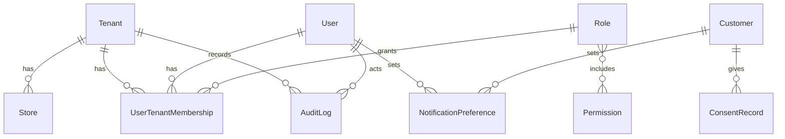
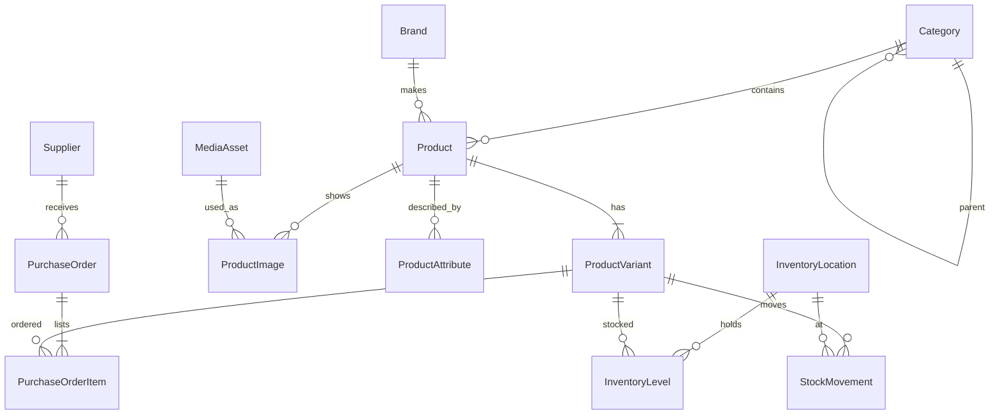
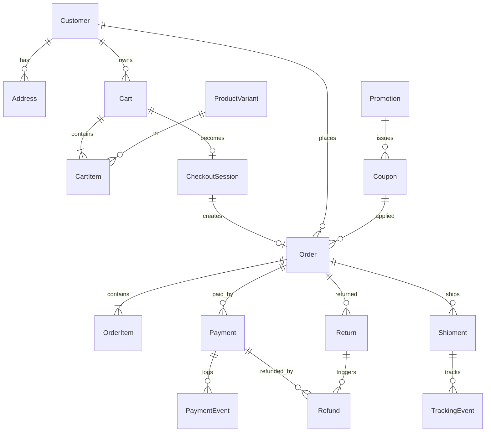
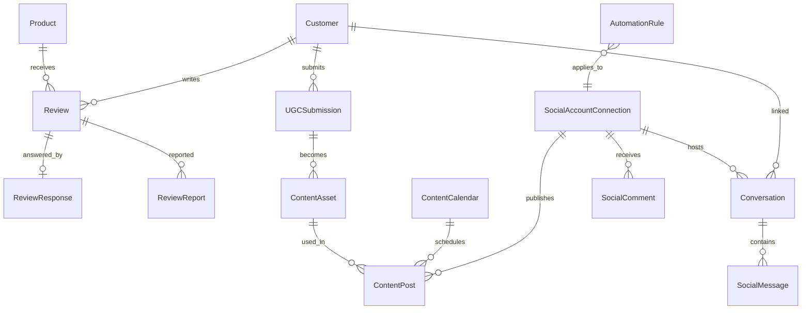
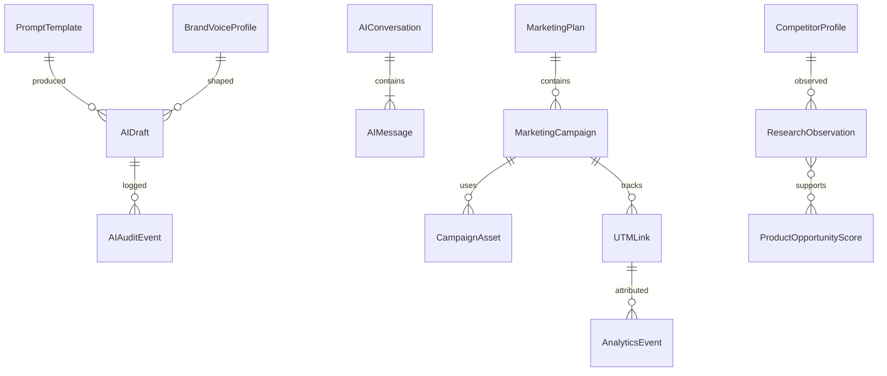
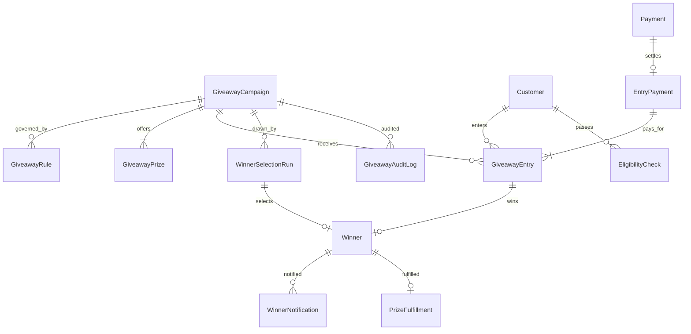

# Data Model

Last updated: 2026-11-11 (Milestone 1.3). `packages/db/prisma/schema.prisma` and the migrations are the source of truth. Sections 1 and 7 below are implemented; the rest is still design.

**Implemented so far:** `tenants`, `stores`, `users`, `roles`, `permissions`, `role_permissions`, `user_tenant_memberships`, `audit_logs`, `consent_records`, `notification_preferences`, `feature_flags`, `idempotency_keys`, `outbox_events`, `jobs`, and the authentication tables `sessions`, `accounts`, `verifications`, `two_factors`.

## Conventions

- Naming: this document uses model names (`Tenant`); in the database, tables are plural snake_case (`tenants`) and columns are snake_case.
- Primary keys: UUID v7 (time-ordered), column `id`, generated by the client.
- Every tenant-owned table has `tenant_id` (not null, indexed, covered by an RLS policy). Store-scoped tables also have `store_id`.
- `created_at`, `updated_at` on every table. Soft delete (`deleted_at`) only where history must survive (products, customers, users).
- Money: integer minor units (`*_amount`) plus `currency` (ISO 4217).
- Statuses are database enums.
- Uniqueness is per tenant: for example `(tenant_id, slug)`, `(tenant_id, sku)`.
- Append-only tables (no update or delete, enforced by trigger): `AuditLog`, `StockMovement`, `PaymentEvent`, `TrackingEvent`, `AIAuditEvent`, `GiveawayAuditLog`, `WinnerSelectionRun`, order events.
- Translatable text (product name, description, SEO fields, category name) lives in `*Translation` tables keyed by locale.

## 1. Tenancy and users

| Table | Key fields |
| --- | --- |
| Tenant | name, slug, status, plan_id, ai_monthly_budget_amount, automation_paused |
| Store | tenant_id, name, slug, default_locale, default_currency, timezone, domains, branding (JSON), settings (JSON) |
| User | email (unique), password_hash, mfa_enabled, is_platform_admin, status |
| Role | tenant_id (null for system roles), key, name |
| Permission | key (`module.action`), description |
| UserTenantMembership | user_id, tenant_id, role_id, store_ids (optional restriction), status |
| AuditLog | tenant_id, actor_type, actor_user_id, action, entity_type, entity_id, before, after, ip, request_id. No foreign keys, so entries outlive what they describe. Update, delete and truncate are rejected by trigger for every role. |
| ConsentRecord | tenant_id, subject_type (user, customer), subject_id, purpose (marketing_email, marketing_sms, cookies_analytics, cookies_marketing, ugc_reuse), granted, source, policy_version, recorded_at. One row per decision; withdrawal adds a row. `subject_id` gets a foreign key to customers in Phase 3. |
| NotificationPreference | subject (user or customer), channel, category, enabled |

**Access rules implemented (runtime role `app_user`):**

| Table | Read | Write |
| --- | --- | --- |
| tenants | Own row | Update own row; no create or delete |
| stores, consent_records, notification_preferences, idempotency_keys, outbox_events, jobs | Own tenant | Own tenant |
| store_domains, categories, brands, products, product_variants, product_attributes, media_assets, product_images | Own tenant | Own tenant |
| user_tenant_memberships | Own tenant, plus the signed-in user's own memberships elsewhere | Own tenant |
| users | Self and members of the current tenant; never `password_hash` or `is_platform_admin` | Own `name` only |
| roles | System roles and own tenant's | Own tenant's non-system roles |
| role_permissions | For visible roles | For own tenant's roles |
| permissions | All (global catalogue) | None |
| feature_flags | Global defaults and own tenant's | Own tenant's |
| audit_logs | Own tenant | Insert for own tenant only |
| sessions, accounts, verifications, two_factors | None | None |

The four authentication tables follow the shape the Better Auth library requires. `accounts.password` holds the Argon2id hash for email-and-password sign-in (provider `credential`); `users` no longer has a password column. `two_factors` holds the encrypted authenticator secret and backup codes. `users` gained `email_verified` and `image`, and `name` is now required (empty by default). Helper functions used by the policies live in the `app_private` schema.

Platform administrator is the `is_platform_admin` flag on a user, not a membership. The plan reference on `Tenant` (`plan_id`) arrives in Phase 9.

Staff (`User`) and shoppers (`Customer`) are separate. A shopper with a login has a `CustomerAccount` credential linked to `Customer`; a guest has a `Customer` row with no credential.

## 2. Catalog and inventory

| Table | Key fields |
| --- | --- |
| Category | parent_id, name, slug, position, seo_title, seo_description, image_asset_id |
| Brand | name, slug, logo_asset_id |
| Product | name, slug, description, short_description, seo_title, seo_description, brand_id, category_id, audience_tags[], material, care_info, tax_class, status (draft, active, archived), is_featured, is_new_arrival, is_best_seller, search_vector |
| ProductVariant | product_id, sku, barcode, color, size, option_values (JSON), cost_amount, price_amount, discount_price_amount, compare_at_amount, currency, weight_grams, length_mm, width_mm, height_mm, low_stock_threshold, position, status |
| ProductImage | product_id, variant_id (optional), media_asset_id, alt_text, position |
| MediaAsset | kind (image, video), storage_key, mime_type, bytes, width, height, duration_ms, checksum, variants (JSON), uploaded_by |
| ProductAttribute | product_id, key, value (specifications such as strap length, movement type) |
| Supplier | name, contact, lead_time_days, notes |
| PurchaseOrder / PurchaseOrderItem | supplier_id, status, expected_at; variant_id, quantity_ordered, quantity_received, unit_cost_amount |
| InventoryLocation | name, address, is_default |
| InventoryLevel | variant_id, location_id, on_hand, reserved, damaged; `available = on_hand - reserved - damaged` |
| StockMovement | variant_id, location_id, quantity_delta, bucket (on_hand, reserved, damaged), reason (purchase, sale, return, adjustment, damage, reservation, release), reference_type, reference_id, actor_user_id, note |

`is_best_seller` is a manual flag; a computed best-seller ranking from real order data is used for sorting. Stock levels shown to shoppers and given to the AI always come from `InventoryLevel`.

**Implemented so far (Milestone 2.1):** `categories`, `brands`, `products`, `product_variants` and `product_attributes`. Each has `tenant_id`, Row-Level Security (own tenant only, read and write) and these rules in the database:

- URL names (`slug`) are unique per tenant and limited to lowercase letters, digits and hyphens. SKUs are unique per tenant.
- A category parent, a product's category and brand, and a variant's or attribute's product must be in the same tenant (trigger, decision D34).
- Prices are never negative; a sale price is below the price and a compare-at price above it; currency is a three-letter uppercase code.
- Deleting a category or brand leaves its products in place without that category or brand. A category with sub-categories cannot be deleted.

**Media (Milestone 2.2):** `media_assets` and `product_images`, plus `categories.image_asset_id` and `brands.logo_asset_id`. Rules in the database:

- `media_assets.storage_key` must start with `public/<the row's tenant id>/`, so a tenant cannot register a file under another tenant's prefix.
- `media_assets` also has `status` (processing, ready, failed) and `processing_error`; `variants` is a list of `{ key, width, height, bytes, mimeType }`.
- A product image's product, variant and asset, a category's image and a brand's logo must be in the same tenant; an image's variant must belong to the image's product.
- An asset is used in one place only (unique links). Deleting the asset removes the product image row and clears a category or brand link.
- The lowest `position` is the main image (decision D41). Alternative text is 300 characters at most.

**Search (Milestone 2.3):** `products.search_vector` (type `tsvector`, GIN index) is filled by the trigger `products_search_vector` on insert and whenever the name, descriptions, material or audience tags change (decision D42). A partial index on `(tenant_id, created_at DESC) WHERE status = 'active'` serves storefront lists.

Not yet built from this section: video (`duration_ms`), and the supplier, purchase-order and inventory tables (Milestone 3.2).

## 3. Commerce

| Table | Key fields |
| --- | --- |
| Customer | email, phone, first_name, last_name, locale, status, assigned_agent_id, deletion_requested_at, anonymized_at |
| Address | customer_id, type, name, line1, line2, city, region, postal_code, country, phone, is_default |
| Cart / CartItem | customer_id or anonymous token, currency, expires_at; variant_id, quantity, unit_price_amount snapshot |
| CheckoutSession | cart_id, email, shipping_address, billing_address, shipping_method, coupon_id, totals (JSON), idempotency_key, status, expires_at |
| Order | number (per-store sequence), customer_id, status, currency, subtotal_amount, discount_amount, shipping_amount, tax_amount, total_amount, refunded_amount, address snapshots, coupon_id, placed_at |
| OrderItem | order_id, variant_id, name/sku/price snapshots, quantity, tax_amount, discount_amount |
| OrderEvent | order_id, type, from_status, to_status, actor, note (internal notes and full history) |
| Payment | order_id (or giveaway entry payment), provider, provider_payment_id, status, amount, currency, method_brand, method_last4, idempotency_key |
| PaymentEvent | provider, provider_event_id (unique per provider), type, payload, signature_verified, processed_at |
| Refund | payment_id, return_id, amount, reason, status, provider_refund_id, actor_user_id |
| Shipment | order_id, carrier, service, tracking_number, label_asset_id, status, shipped_at, delivered_at |
| TrackingEvent | shipment_id, status, description, location, occurred_at |
| Return | order_id, items (JSON), reason, status (requested, approved, rejected, received, refunded), approved_by |
| Coupon | code, promotion_id, usage_limit, per_customer_limit, used_count, starts_at, ends_at |
| Promotion | name, type (percent, fixed, free_shipping, buy_x_get_y), value, conditions (JSON), starts_at, ends_at, status |
| GiftCard | code_hash, initial_amount, balance_amount, currency, expires_at (deferred until needed) |
| WishlistItem | customer_id, product_id |

## 4. Reviews, content and social

| Table | Key fields |
| --- | --- |
| Review | product_id, customer_id, order_item_id (verified purchase when set), rating, title, body, media, status (pending, approved, rejected, hidden), ai_flags (JSON) |
| ReviewResponse | review_id, author_user_id, body |
| ReviewReport | review_id, reporter, reason, status |
| ProductQuestion / ProductAnswer | product_id, customer_id, body; author, body |
| UGCSubmission | customer_id, product_id, media_asset_id, caption, moderation_status, permission_status (not_requested, requested, granted, denied, expired), permission_granted_at, permission_expires_at |
| ContentAsset | media_asset_id, source (upload, ugc, ai_enhanced), folder, tags[], derived_from_asset_id |
| ContentPost | platform, connection_id, type (post, reel, story, carousel), caption, hashtags[], asset_ids[], product_ids[], status (draft, pending_approval, approved, scheduled, published, failed), scheduled_at, published_at, platform_post_id, approved_by, utm_link_id |
| ContentCalendar | name, period, campaign_id |
| SocialAccountConnection | platform, external_account_id, display_name, access_token_encrypted, refresh_token_encrypted, token_expires_at, scopes[], capabilities[], status (connected, expired, revoked) |
| Conversation | connection_id, channel (dm, comment_thread), external_thread_id, customer_id, assigned_user_id, status, priority, tags[], sla_due_at, automation_paused |
| SocialMessage | conversation_id, direction, external_id (unique per connection), body, attachments, sent_by_user_id, ai_draft_id, received_at |
| SocialComment | connection_id, external_id (unique per connection), post_external_id, author_handle, body, classification, reply_status |
| SavedReply | title, body, tags[] |
| AutomationRule | scope, trigger, conditions (JSON), action, level (draft, approval, auto), enabled |
| WebhookEvent | source, external_event_id (unique per source), payload, signature_verified, status, attempts |

## 5. AI and marketing

| Table | Key fields |
| --- | --- |
| PromptTemplate | task, version, system_text, user_template, output_schema, model_hint, status (draft, active, retired) |
| BrandVoiceProfile | tone, vocabulary, banned_phrases, examples, languages |
| AIConversation / AIMessage | user_id, purpose; role, content, tokens |
| AIDraft | task, target_type, target_id, input_hash, output (JSON), status (pending, approved, edited, rejected, applied, sent), reviewed_by, template_version |
| AIAuditEvent | task, provider, model, template_version, input_tokens, output_tokens, cost_amount, latency_ms, outcome, redactions_applied, draft_id, actor |
| AIUsageCounter | tenant_id, period, tokens, cost_amount, request_count (quota enforcement) |
| MarketingPlan | objective, period, personas (JSON), pillars (JSON), calendar (JSON), budget_scenarios (JSON), kpis (JSON), status, generated_by_draft_id |
| MarketingCampaign | plan_id, name, objective, channel, audience (JSON), product_ids[], offer, budget_amount, budget_type (daily, lifetime), starts_at, ends_at, status, external_account_id, external_campaign_id, confirmed_by, confirmed_at |
| CampaignAsset | campaign_id, content_asset_id, role |
| CustomerSegment | name, definition (JSON), consent_required |
| CompetitorProfile | name, url, platform, categories[], notes |
| ResearchObservation | competitor_id, kind (product, price, post, hook, hashtag, comment), data (JSON), source_url, collected_at, collection_method (manual, api, fetch), **origin (observed)** |
| ProductOpportunityScore | subject, score, rationale, observation_ids[], **origin (ai_generated)**, model, created_at |
| AnalyticsEvent | store_id, name, session_id, customer_id, properties (JSON), utm fields, occurred_at; partitioned by month |
| UTMLink | campaign_id, destination_url, source, medium, campaign, content, short_code |

Observed facts and AI output are in different tables with an explicit `origin`, so the UI can never present a recommendation as an observation.

## 6. Giveaways

| Table | Key fields |
| --- | --- |
| GiveawayCampaign | title, slug, description, entry_price_amount, currency, max_entries_per_customer, max_participants, starts_at, ends_at, eligible_countries[], eligible_regions[], min_age, free_entry_enabled, free_entry_instructions, selection_method, result_visibility, terms, privacy_notice, refund_policy, status (draft, scheduled, open, closed, drawn, completed, cancelled) |
| GiveawayRule | campaign_id, key, value (additional structured rules) |
| GiveawayPrize | campaign_id, name, description, image_asset_ids[], value_amount, delivery_info |
| GiveawayEntry | campaign_id, customer_id, entry_payment_id (null for free entry), type (paid, free), sequence_number, status (pending, valid, flagged, excluded, refunded), risk_signals (JSON) |
| EntryPayment | campaign_id, customer_id, payment_id, quantity, amount, receipt_number, status |
| EligibilityCheck | campaign_id, customer_id, country, region, date_of_birth_confirmed, result, reasons |
| WinnerSelectionRun | campaign_id, run_number, started_by_user_id, started_at, method, eligible_count, excluded_count, eligible_list_hash, selected_entry_id, status, result, previous_run_id, redraw_reason |
| Winner | run_id, entry_id, customer_id, status (pending_verification, verified, disqualified, declined), disqualified_reason |
| WinnerNotification | winner_id, channel, sent_at, status |
| PrizeFulfillment | winner_id, prize_id, status, shipment_id, delivered_at, notes |
| GiveawayAuditLog | campaign_id, actor, action, details, occurred_at |

Database guarantees: entries cannot be inserted outside the campaign window or beyond per-customer and participant limits; once a run completes, entries, runs and winners for that campaign reject update and delete.

## 7. SaaS and platform

| Table | Key fields |
| --- | --- |
| Plan | key, name, price_amount, interval, limits (JSON: products, staff, ai_budget, storage_bytes, social_accounts) |
| Subscription | tenant_id, plan_id, status, provider_subscription_id, current_period_end |
| UsageRecord | tenant_id, metric, quantity, period |
| FeatureFlag | tenant_id (null for global), key, enabled |
| Job | tenant_id, queue, name, status, progress, result, error, idempotency_key |
| OutboxEvent | tenant_id, type, payload, processed_at |
| IdempotencyKey | tenant_id, key, request_hash, response, expires_at |
| Notification / NotificationTemplate | recipient, channel, template_key, status, provider_message_id; key, locale, subject, body |

## 8. Indexes

Baseline: every foreign key, and `(tenant_id, created_at)` on every list-view table.

| Purpose | Index |
| --- | --- |
| Product lookup | unique `(tenant_id, slug)`; unique `(tenant_id, sku)` on variants; `(tenant_id, status, category_id)`; `(tenant_id, is_featured)` partial |
| Product search | GIN on `search_vector`; GIN on `audience_tags` |
| Filters | `(tenant_id, price_amount)`, `(tenant_id, color)`, `(tenant_id, material)`, `(tenant_id, brand_id)` |
| Orders | unique `(store_id, number)`; `(tenant_id, status, created_at)`; `(tenant_id, customer_id, created_at)` |
| Payments and webhooks | unique `(provider, provider_event_id)`; unique `(provider, provider_payment_id)`; unique `(source, external_event_id)` |
| Inventory | unique `(variant_id, location_id)`; `(tenant_id, variant_id, created_at)` on movements |
| Social | `(tenant_id, platform, status)`; unique `(connection_id, external_id)`; `(tenant_id, assigned_user_id, status, sla_due_at)` |
| Jobs | `(tenant_id, status, created_at)`; unique `(tenant_id, idempotency_key)` |
| Campaigns | `(tenant_id, status, starts_at)` for marketing and giveaway campaigns |
| Giveaway entries | `(campaign_id, status)`; `(campaign_id, customer_id)`; unique `(campaign_id, sequence_number)` |
| Analytics | `(tenant_id, name, occurred_at)`; `(tenant_id, utm_campaign, occurred_at)`; monthly partitions |
| Audit | `(tenant_id, entity_type, entity_id)`; `(tenant_id, actor_user_id, created_at)` |

## 9. Data lifecycle

- **Customer deletion.** Personal fields on `Customer`, `Address`, messages and reviews are anonymized; orders and payments keep the financial record with the customer reference pointing to the anonymized row.
- **Customer export.** One job assembles profile, addresses, orders, reviews, consents, conversations and giveaway entries into a downloadable archive.
- **Retention.** Defaults for webhook payloads, analytics events, AI inputs and logs are set per table and documented in the data-retention guide (a completion deliverable).
