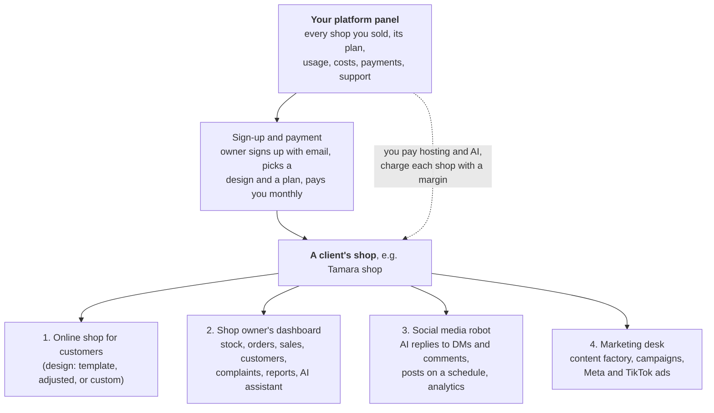

# Platform Roadmap: from one shop to a platform you sell

Last updated: 2026-11-20. Written from the owner's own plan (diagram, 2026-11-20). Plain language; the technical plan is [PROJECT_PLAN.md](../PROJECT_PLAN.md), the selling story [BUSINESS_BLUEPRINT.md](BUSINESS_BLUEPRINT.md).

## 1. The idea, as one picture

Two products in one:

- **The shop system** (boxes 1 to 4): what each client uses every day. **Mostly built.**
- **The platform** (your panel, sign-up, designs, plans and payments, margins): how you sell and run many shops. **Mostly not built yet.** The foundation is in place: every table already separates shops from each other (multi-tenant from day one), so this is adding screens and billing, not rebuilding.

## 2. Where you are today

| Your box | What it needs | Status |
| --- | --- | --- |
| **Your admin panel** (all websites you sold) | List of shops, create a shop, each shop's plan, usage and costs, payments, suspend, support access | ✅ Built 2026-11-20 (D120): dashboard, shops, new shop, shop page with suspend and resume. 🟡 Plans, payments and support access come with Stages C and D |
| **Website design** (drag and drop on templates / adjusted / custom) | Templates, a page builder, custom themes | 🟡 4 ready-made looks to choose from at sign-up (D121), each with logo, colour, font and corner controls, plus Arabic. No layout variants yet, no drag and drop |
| **Sign up with email, pay you for hosting** | Self-service sign-up, plans, subscription payments, your margin | ✅ Sign-up built 2026-12-01 (D121): public platform site, 14-day free trial, setup guide. ❌ Plans and payments (Stage D) |
| **AI assistance resold with a margin** | Metered AI use per shop, priced with your margin | 🟡 Every AI use is recorded with its real cost per shop, with a monthly budget per shop. Not yet turned into a bill |
| **Shop for normal users** | Catalog, search, cart, checkout, accounts | ✅ Built (cash on delivery; card payments wait for a merchant account) |
| **Shop owner's dashboard: stock, inventory, sales, orders** | | ✅ Built, with returns, discounts, delivery, emails, reports and forecasts |
| **AI assistance** | | ✅ Product descriptions, Arabic, captions, research ideas, questions about the reports |
| **Complaints** | | ✅ One inbox for the contact form, Instagram and Facebook, with AI sorting |
| **Content factory for social media** | | ✅ Photo library, sizes for each platform, AI captions, approval, calendar. 🟡 Video (reels, stories) posted by hand |
| **Facebook and Instagram** | | ✅ Connected, tested for real. 🟡 Real customers need Meta's approval (Advanced access) |
| **TikTok** | | ❌ Needs a TikTok developer app and its review |
| **Manage sponsors and ads (Meta ads)** | | ❌ Planned (Milestone 7.3); needs an ad account and Meta's review |
| **AI bot replies to DMs and comments** | | ✅ Automatic replies in English and Lebanese Arabic, tested for real on Instagram |
| **Posts on a schedule from the content factory** | | ✅ Photo posts and carousels, now or at the planned time. 🟡 Needs the site online (Meta downloads the photos) |
| **Analytics** | | ✅ Shop reports (sales, products, searches, campaigns). 🟡 Social analytics (views, reach per post) wait for Meta's insights permission |
| Launch safety | Security, backups, monitoring, accessibility, speed | ✅ Done on the development computer |

**In one line:** the shop system is about 80% done and works for one shop; the platform you sell from is about 35% done (your panel, the public site and sign-up; plans and payments next).

## 3. Gaps your diagram does not show yet

These matter for selling to many shops. Each has a step in section 4.

1. **Meta "Tech Provider" approval.** To manage *other businesses'* Pages and Instagram accounts through your one Meta app, Meta requires your business to be verified and approved as a Tech Provider, plus App Review for each permission. Your Meta dashboard already shows "Become a Tech Provider". Without it, every client would need their own Meta developer app, which is not realistic.
2. **How a client pays you, and how you get paid in Lebanon.** Stripe does not accept Lebanese businesses. Options: a "merchant of record" service that sells subscriptions for you worldwide and pays you out (Paddle, Lemon Squeezy; check they pay out to you), a Lebanese gateway with recurring payments (areeba), or, at the start, monthly invoices paid by Whish, OMT or bank transfer, recorded in your panel.
3. **Web addresses for each shop.** Every shop needs an address: a free one under your platform (tamara.yourplatform.com) and optionally its own domain (tamarashop.com) with automatic HTTPS.
4. **Hosting model.** One shared installation serving all shops (cheap, one server to look after, already how the code works), with an option of a separate server for big or custom clients at a higher price.
5. **Usage limits per plan.** How many products, staff, AI replies, emails and posts each plan includes, and what happens past the limit (a top-up, an upgrade, or a pause).
6. **Your costs, so your margin is real.** Server, database, file storage, email sending, AI, domains, the payment provider's fee. The panel should show cost and price per shop.
7. **Trials, failed payments, cancelling.** A free trial, reminders when a payment fails, a grace period, then the shop is paused (not deleted); a clean data export if a client leaves.
8. **Legal.** Your terms of service and privacy terms for shop owners (separate from each shop's own policies, which already exist), including what you do with their customers' data.
9. **Support for clients.** Signing in to a client's admin to help them, only with their permission and always recorded in the audit log; a help page; a way for them to reach you.
10. **WhatsApp.** In Lebanon most shopping questions arrive on WhatsApp. The WhatsApp Business API (also Meta) would put WhatsApp messages in the same inbox with the same AI replies. Not in your diagram; strongly worth adding.
11. **Video.** The content factory handles photos; reels and stories (video) are where most reach is on Instagram and TikTok.

## 4. The plan, step by step

Each stage ends with something you can show or sell. Times are rough, for one developer with AI help.

### Stage A: Go live with your first shop (about 1 to 2 weeks, mostly waiting on Meta)
Your pilot and your live demo for selling.
1. **Business verification** in Meta Business settings (start now; days to two weeks).
2. **A domain and a server**: the shop online with HTTPS, a permanent webhook address instead of the tunnel, file storage online (so publishing works), email from your own domain.
3. **Meta App Review** for messages, comments, publishing and insights, with a screen recording of each (prepared together). Add the Messenger use case for Facebook messages.
4. **Apply to be a Tech Provider** (gap 1), so the same app can serve your future clients.
5. Real speed measurements on the live site; card payments when a merchant account exists.

### Stage B: Your platform panel (built 2026-11-20, D120; support access still to do)
The "My admin dashboard" box.
1. A separate area only you can open (platform administrator, already in the access rules): every shop with its status, plan, owner, web address and creation date.
2. Create a shop from the panel (today a command), with its first owner invited by email.
3. Per shop: AI cost this month, orders, products, storage, emails sent, last activity.
4. Suspend and resume a shop; notes about the client.
5. Support access: open a client's admin only with their permission, recorded in the audit log.

### Stage C: Sign-up and onboarding (steps 1 to 3 built 2026-12-01, D121; email confirmation and own domains still to do)
The "they sign in with email address" part.
1. A public page for your platform: what it does, plans and prices, "Start free trial".
2. Sign-up with email, confirmation, shop name, the free web address (shopname.yourplatform.com).
3. A setup guide inside the new shop: logo and colours, delivery, first products (or the spreadsheet import), policies, connect Instagram and Facebook.
4. Own domain: the client types their domain, gets the DNS instructions, HTTPS is made automatically.

### Stage D: Plans and payments with your margin (about 2 weeks)
The "pay me for hosting, I add a margin" and "same for AI" parts.
1. Plans with prices you set (Starter, Growth, Pro; see BUSINESS_BLUEPRINT.md) and what each includes (gap 5).
2. Subscription payments through the provider you choose (gap 2), or invoices recorded by hand at first.
3. AI credits: the real AI cost per shop is already recorded; each plan includes an amount, top-ups are sold at cost plus your margin, and the AI pauses at the limit instead of overspending.
4. Hosting: a monthly hosting fee per plan above your real cost (gap 6); your panel shows cost, price and margin per shop.
5. Trials, failed-payment reminders, grace period, pause, export (gap 7).

### Stage E: Designs: templates, builder, custom (about 3 to 4 weeks)
The "drag and drop on ready templates, slightly customized, or pure customized, for a different price" box. Recommended in three tiers:
1. **Templates** (lowest price): 3 to 5 complete shop designs to choose from (for example minimal, bold, luxury, Arabic-first), each with the colour and font controls that already exist.
2. **Section builder with drag and drop** (middle price): the home page and landing pages made of ready sections (big picture banner, featured products, categories, real reviews, Instagram photos, text and image) that the owner adds, removes, reorders by dragging and edits in place, with a preview. This gives most of the freedom of Wix-style builders at a fraction of the work, and the shop stays fast and accessible.
3. **Custom design** (highest price, your service): you build a design for one client on top of the same system, maintained by you.

A free-form "move anything anywhere" builder is not recommended: very large to build and it tends to produce slow, broken pages on phones.

### Stage F: More channels and ads (ongoing)
1. **WhatsApp Business** in the same inbox with AI replies (gap 10).
2. **Meta ads** (Milestone 7.3): drafts, preview, your approval, then launch; results in the reports.
3. **Social analytics**: views, reach and saves per post, best posts and times (needs Meta's insights permission from Stage A).
4. **Video**: reels and stories publishing; TikTok publishing after TikTok's review (gap 11).
5. Giveaways (Phase 8), once the legal question is settled (COMPLIANCE.md).

## 5. Decisions only you can make

| # | Decision | Needed by |
| --- | --- | --- |
| 1 | Your platform's name and domain (separate from Moonlight) | Stage C |
| 2 | Prices of the plans, of design tiers, of AI top-ups | Stage D |
| 3 | How clients pay you (gap 2) | Stage D |
| 4 | Shared hosting for everyone, or separate servers for some clients | Stage A/B |
| 5 | Which templates first (styles your clients will want) | Stage E |
| 6 | Your terms of service and refund rules (with a lawyer) | Before the first paying client |
| 7 | WhatsApp before or after the design builder | Stage F order |

## 6. Recommended order and why

**A → B → D (simple) → C → E → F.** Go live first with your own shop: it proves everything works and becomes your demo. Then your panel (you need it as soon as you have a second client). Then payments in a simple form (you can sign the first clients by hand with invoices while sign-up is built), then self-service sign-up, then the design builder, which becomes your price ladder. Channels and ads grow alongside.
