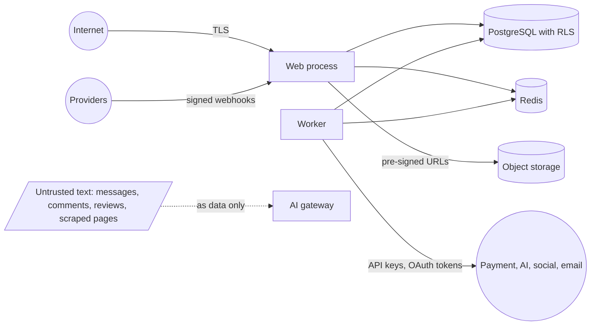

# Security Threat Model and Checklist

Last updated: 2026-11-11 (Milestone 1.3). Reviewed again at the end of each phase and fully in Phase 10.

## 1. Assets

| Asset | Why it matters |
| --- | --- |
| Customer personal data (names, addresses, emails, phones, messages, dates of birth for giveaways) | Privacy law, trust |
| Tenant business data (orders, costs, suppliers, customers, plans) | Confidential between tenants |
| Payment flows and refunds | Direct financial loss |
| Giveaway entries and draw results | Financial and legal exposure, fairness |
| Social and ads OAuth tokens | Account takeover, public posting, ad spend |
| AI provider keys and budget | Cost, data exposure |
| Staff accounts, especially owners and platform administrators | Access to everything above |
| Secrets (database, encryption key, webhook secrets) | Full compromise |

## 2. Actors

Anonymous internet users and bots; shoppers; staff with limited roles; a staff member of another tenant; a compromised staff account; authors of content the system ingests (comments, messages, reviews, competitor pages); providers sending webhooks, and anyone forging them.

## 3. Trust boundaries

## 4. Threats and mitigations

| # | Threat | Mitigation | Verified by |
| --- | --- | --- | --- |
| T1 | Cross-tenant read or write (IDOR, missing filter) | Tenant from session or host only; tenant-scoped client; RLS; 404 for foreign records | Two-tenant isolation suite over every service and route |
| T2 | Privilege escalation within a tenant | Permission per route and service method; role changes need `staff.manage` and are audited; no role can grant above itself | Role and permission boundary tests |
| T3 | Account takeover | **Built (1.3):** Argon2id hashing; lockout after 5 failures per account or 30 per address in 15 minutes; optional two-factor with backup codes; HTTP-only same-site cookies, HTTPS-only when `APP_URL` is HTTPS; sessions checked against the database on every request; reset links single-use, 30 minutes, and ending all sessions; identical responses for unknown accounts; no sign-up and no public auth API. **Not yet:** two-factor enforcement by role (1.4); notification email on password or two-factor change. | Unit, integration and end-to-end auth tests |
| T4 | Forged or replayed webhooks | Signature over raw body; timestamp tolerance; event ID de-duplication | Webhook forgery tests |
| T5 | Payment tampering (client changes amount, marks order paid) | Totals computed on the server; order paid only from verified webhook; idempotency keys | Checkout integration tests |
| T6 | Unauthorized refund | `orders.refund` permission; refund never exceeds captured minus refunded; audit entry | Refund authorization and calculation tests |
| T7 | Overselling through races | Reservation in a transaction with row locks; expiry job | Concurrency tests |
| T8 | SQL injection | Prisma parameterized queries; raw SQL only through tagged templates; whitelisted filter and sort fields | Injection tests |
| T9 | XSS (reviews, messages, product copy, AI output) | React escaping; sanitized rich text with an allowlist; CSP; AI output treated as untrusted text | XSS tests |
| T10 | CSRF | Same-site cookies; origin check; CSRF token on cookie-authenticated mutations | CSRF tests |
| T11 | Malicious uploads | Pre-signed uploads to a separate origin; type and size allowlist verified by content sniffing; images re-encoded; no SVG or HTML from users; UGC private until moderated | Upload restriction tests |
| T12 | SSRF through competitor URLs or media import | Allowlisted schemes; block private and link-local ranges after DNS resolution; no redirects to blocked ranges; size and time limits; honor robots.txt | SSRF tests |
| T13 | Prompt injection through customer or scraped text | Untrusted text delimited as data; model has no state-changing tools; output schema validation; grounded-fact citation requirement; approval levels; sensitive categories always human | Prompt-injection test set |
| T14 | AI leaks personal or cross-tenant data | Minimize and redact before sending; context assembled only from the caller's tenant; no cross-tenant caches; provider data-retention settings reviewed | AI data-access tests |
| T15 | AI or API cost exhaustion | Per-tenant quotas, budgets and rate limits; hard monthly cap; alerts | Quota tests |
| T16 | OAuth token theft | Tokens encrypted at rest with a key outside the database; never logged or returned by the API; state and PKCE on OAuth flows; least scopes | Secret-exposure tests |
| T17 | Unintended ad spend or publishing | Draft by default; `ads.launch` permission; explicit confirmation naming account and budget; kill switch; mocks only in tests | Ads workflow tests |
| T18 | Giveaway manipulation (edit entries, rig draw, silent redraw) | CSPRNG; draw recorded with eligible-list hash; post-draw immutability by trigger; redraw needs reason, permission, new audit record, old result preserved | Winner-selection, redraw and unauthorized-change tests |
| T19 | Giveaway fraud (duplicate accounts, stolen cards, entry stuffing) | Payment verification; per-customer limits in the database; duplicate signals (email normalization, payment fingerprint, device and IP); flags reviewed by a person; rate limits | Entry-limit and duplicate tests |
| T20 | Secrets committed or logged | `.env` ignored; secret scanning in CI and pre-commit; log redaction; env validation | Secret scan |
| T21 | Vulnerable dependencies | Lockfile; dependency audit in CI; automated update PRs | CI |
| T22 | Scraping, credential stuffing, checkout abuse | Rate limits; bot challenge on sensitive forms if abuse appears | Rate-limit tests |
| T23 | Staff misuse or mistakes | Audit log for sensitive actions; export and deletion need dedicated permissions; impersonation is logged and visible | Audit tests |
| T24 | Data loss | Automated backups, point-in-time recovery where available, tested restore, object-storage versioning | Restore test in Phase 10 |

## 5. Security checklist

Applied to every milestone before it is called done.

- [ ] Every new route declares a permission and has an isolation test.
- [ ] Every new tenant-owned table has `tenant_id`, an RLS policy and is covered by the scoped client.
- [ ] All input validated by schema on the server; unknown fields rejected.
- [ ] Mutations that move money, stock, entries or public content take an idempotency key.
- [ ] Sensitive actions write an audit log entry.
- [ ] No secret, token or full personal record appears in logs, errors or API responses.
- [ ] User-supplied text is escaped or sanitized wherever it is rendered.
- [ ] External calls have timeouts, retries where safe, and a feature flag.
- [ ] New environment variables are added to `.env.example` and the env validator, with placeholders only.
- [ ] Rate limits set for new public or expensive routes.
- [ ] Dependency audit and secret scan pass.

## 6. Residual risks accepted for now

- Session tokens are stored unhashed by the authentication library. The table is closed to the runtime database role; exposure requires owner-level database access or a leaked backup. Backups must be encrypted and access-controlled.
- A two-factor code can be replayed within its 30-second window.
- The client address used for rate limits and the audit log is taken from `X-Forwarded-For`; production must run behind a proxy that sets it. Per-account lockout does not depend on it.
- Per-account lockout lets an attacker lock a known staff email out for 15 minutes at a time. Accepted in exchange for brute-force protection; password reset still works during a lockout.

- No web application firewall or bot management until traffic justifies it.
- Device fingerprinting for giveaway fraud is limited to basic signals to respect privacy rules.
- AI output quality is reduced, not eliminated, as a risk; human approval is the default for customer-facing output.
